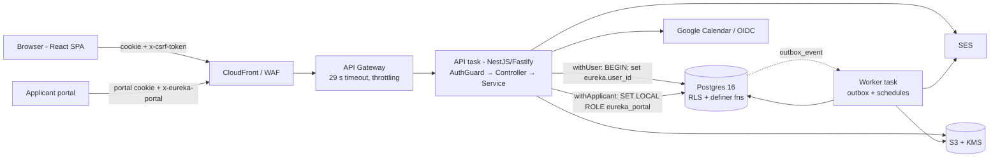

# Eureka backend — architecture map and module scorecards

> Production-readiness and architecture review, 2026-11-05, at `29521eb` (origin/main).
> Read-only audit: no production code changed. Companion documents:
> [api-review.md](api-review.md) · [security-review.md](security-review.md) ·
> [performance-review.md](performance-review.md) · [refactoring-roadmap.md](refactoring-roadmap.md)

## 0. How this audit was run

| Step | What |
|---|---|
| Skills used | The project's own review skills, verified present in `.claude/skills/`: **eureka-security-gate** (access-control / integrity / exposure / ops checklist), **eureka-sql-review** (8 DB rules), **eureka-rls-policy** (InitPlan patterns, review checklist), **eureka-mass-assignment** (server-managed field conventions). The built-in **engineering:tech-debt** severity/effort framing was applied to the roadmap. |
| Reviewers | Seven independent reviewers, one per module group (A–G below), each with the same rubric (10 dimensions, scored 1–5, with file:line evidence for each) and an instruction to drop anything they could not confirm in code. |
| Lead verification | Every **High** finding, plus the most consequential Mediums (A-04, G-01, G-02), was re-checked against the code by the lead reviewer before ranking. Severity changes are marked **Lead review** in the finding. |
| Limits | Static analysis only. The test suite was not run, Postgres was not started and no `EXPLAIN` was taken. Each performance finding is labelled **PROVEN**, meaning visible in code, query shape or configuration, or **HYPOTHESIS**, meaning it needs profiling. No improvement is claimed without a measurement. |

Result: 85 findings — Critical 0, High 5, Medium 36, Low 44 (reviewer severities; see lead adjustments). **No Critical findings.** The security model is unusually mature for an internal
platform (triple-layer authz, 353 InitPlan-form RLS policies, hardened definer functions, no SQL
injection surface, no PII in events). The weak spots are **operational resilience** (pool, timeouts,
observability), a **privilege-escalation gap in custom roles**, and **consistency debt**: the same
concern (concurrency, idempotency, pagination, state machines) is solved well in some modules and
missing in others.

## 1. Stack and dependencies

| Layer | Technology | Notes |
|---|---|---|
| Runtime | Node 22, TypeScript 5.9, ESM, SWC build | `apps/api/package.json` |
| HTTP | NestJS 10 on **Fastify 4** | `bodyLimit: 1 MiB`, `trustProxy: false` (app.module.ts:168-172) |
| Validation | **zod** 3 — 210 `.strict()` schemas | Errors → RFC 9457 `application/problem+json` (platform/errors.ts) |
| Data access | Raw **pg** 8 — no ORM, no query builder | All SQL parameterised; scope enforced by RLS |
| Database | PostgreSQL 16 — 100 tables, 377 `CREATE POLICY`, 182 indexes, 90 function files (`db/functions/authz` 60, `eureka` 27) | 115 append-only, checksum-pinned migrations |
| AuthN | Google OIDC (PKCE + nonce + state, `jose`), optional password login (bcrypt 12), opaque hashed server sessions, CSRF header token, step-up grants | `platform/oidc.service.ts`, `session.service.ts`, `step-up.ts` |
| AuthZ | Shared permission catalog + `can()` engine (`packages/shared/src/authz`) → `@RequirePermission` guard → RLS → SECURITY DEFINER re-check | Six DB roles: `eureka_owner`, `eureka_app`, `authz_definer`, `eureka_worker`, `eureka_portal`, `eureka_import` |
| Files | S3 presigned POST/GET, KMS field encryption, GuardDuty + content inspection, quarantine → promote | `platform/storage`, `worker/document-store.ts` |
| Mail | SES v2 | `platform/mail.ts` |
| Async | Separate **worker** process: transactional outbox + daily/monthly scheduled jobs | `worker.ts`, `worker/runner.ts`, `worker/schedule.ts` |
| Other deps | `exceljs`, `read-excel-file` (import/export), `rxjs` (Nest peer) | No new dependencies recommended by this audit, except optionally `pg_trgm`, a Postgres extension (see R-13) |
| Infra | Terraform/Terragrunt, ECS behind API Gateway (29 s timeout), CloudFront/WAF | AWS compute currently deleted; production `worker_desired_count = 0` ("Phase 2") |

## 2. Runtime topology



## 3. Request lifecycle (staff route)

1. `originGuard` (Origin/Sec-Fetch checks) → Fastify body parse (1 MiB cap).
2. `AuthGuard.canActivate` (platform/auth.guard.ts):
   portal routes are dispatched to `portal()`, and any staff route under `/api/portal` is refused; `@Public` routes stop here;
   `SessionService.resolve(cookie)` (DB) → CSRF check on unsafe methods →
   `db.withUser` → `AccessService.load` + temp-password check (DB) → `can(access, @RequirePermission)`.
   **Default:** authenticated user passes when no `@RequirePermission` is present (F-08).
3. Controller parses `@Body()/@Query()` with zod `.strict()` → service.
4. Service opens **one transaction per request** via `DbService.withUser(userId, fn)`:
   `BEGIN; set_config('eureka.user_id', …, true)`; RLS computes scope from tables;
   sensitive writes call `authz.*` SECURITY DEFINER functions that re-check permission and scope
   and write `audit_event` / `outbox_event` in the same transaction.
5. Coded DB errors (`RAISE EXCEPTION 'stale'`) → `dbErrorMapper` → module `*.errors.ts` → HTTP;
   everything else → `ProblemFilter` (`42501→403`, `P0002→404`, `23505→409`, `23503/23514/22P02→422`, else 500).

Per authenticated request this is **two pool checkouts and about 5–6 round trips before the handler runs** (F-03).
There is **no cache layer** anywhere. That is deliberate: access facts are reloaded per request so that revocation takes effect immediately.

## 4. Module map

Routes are counted from `@Get/@Post/@Put/@Patch/@Delete` decorators in each module directory. `RequirePermission` counts are per-method; several controllers use a class-level decorator (e.g. `AdminController`, admin.controller.ts:38), and identity/portal/notifications/lookups are session-only or portal-only by design.

| Module | Routes | Responsibility | Primary API doc | Score |
|---|---|---|---|---|
| candidates | 24 | Candidate profile, list/search, compliance, transitions, batches, bulk import, timeline | candidates-api.md | 3.5 |
| applications | 11 | Job applications (portal applicants → staff pipeline), CSV export | jobs-portal-api.md | 3.9 |
| submissions | 6 | Candidate→client submissions, pipeline states | submissions-api.md | 3.6 |
| hotlist | 9 | Saved views, bulk actions, export | candidates-api.md | 3.7 |
| resumes | 3 | Résumé upload/versions | candidates-api.md | 4.3 |
| jobs | 6 | Job requirements (client/internal), idempotent create | jobs-portal-api.md | 4.1 |
| placements | 6 | Placement lifecycle (shared state machine) | placements-api.md | 3.9 |
| payments | 9 | Invoices, payments, summaries | payments-api.md | 4.1 |
| contracts | 2 | Contract records on placements | placements-api.md | 3.5 |
| work-authorization | 4 | Visa / I-9 data (encrypted, step-up reveal) | work-authorization-api.md | 4.4 |
| paperwork | 10 | Onboarding checklists, BGC, overdue queue | paperwork-api.md | 3.4 |
| documents | 9 | Upload/download, classification, access log | documents-api.md | 3.8 |
| employees | 14 | Employees, assignments, pay data, reports | employees-api.md | 3.7 |
| admin | 55 | Users, roles, grants, teams, org chart, locations, user import | admin-api.md, roles-api.md | **3.0** |
| identity | 21 | OIDC/password login, me, settings, step-up | admin-api.md | 4.0 |
| staff | 2 | Birthdays | alerts-calendar-birthdays.md | 4.0 |
| lookups | 4 | Reference data | lookups-api.md | 3.6 |
| preferred-vendors | 5 | Vendor list | pipeline-vendors-api.md | 4.1 |
| imports | 6 | Spreadsheet import (API) + CLI (`src/import`) | import.md | 4.0 |
| datahub | 16 | Folder/file sharing with restricted folders | datahub-api.md | 3.9 |
| facilities | 26 | Companies, sites, utilities, bills | facilities-api.md | 4.2 |
| training | 27 | Training batches, students, status | training-api.md | 3.5 |
| performance | 7 | Targets and performance reports | performance-api.md | 3.6 |
| feedback | 2 | **Public** tokenised feedback | — (no doc, D-11) | 3.7 |
| notifications | 5 | In-app notifications | notifications.md | 4.3 |
| chat | 19 | Conversations/messages (polling) | chat-api.md | 4.3 |
| interviews | 10 | Interview scheduling, results, board | interviews-settings-api.md | **3.3** |
| interview-reports | 4 | Interview report aggregates | interviews-settings-api.md | 3.8 |
| calendar | 9 | Google Calendar block/release | alerts-calendar-birthdays.md | 3.4 |
| dashboard | 2 | KPI aggregates, "needs attention" | dashboards-api.md | 3.9 |
| pipeline-report | 7 | Pipeline report, assessments, non-response | pipeline-vendors-api.md | 3.5 |
| reports | 2 | Market report | market-reports-api.md | 4.1 |
| portal | 13 | Applicant sign-up/sign-in (magic link), jobs, applications | jobs-portal-api.md | 4.1 |

**Totals:** 355 routes across 39 controllers (146 GET, 129 POST, 31 PATCH, 25 PUT, 24 DELETE); 46 controllers are under `/api/v1`, while auth, portal, public feedback and health are unversioned.

### Layering as implemented

```
controller (route, decorator authz, zod parse, HTTP shaping)
   └─ service (orchestration, engine pre-checks, SQL strings, audit calls)
        └─ DbService.withUser / withApplicant / withSystemTx   ← transaction boundary
             └─ Postgres: RLS policies (read scope) + authz.* definer fns (write rules, audit, outbox)
```

* **No repository layer.** SQL lives in services, and **business rules live in the database**: definer functions, guard triggers and column guards. This is an intentional, well-executed choice, because the database is the security boundary. A generic Repository abstraction would duplicate it without adding protection. **We do not recommend introducing one** (see §6).
* **Domain model** = shared TS types + DB constraints + `packages/shared/src/authz/state-machines.ts` (used by placements/submissions/applications/candidates; **not** by jobs, training batches or parts of paperwork, see R-16).
* **Module boundaries** are mostly clean. Exceptions: `AdminService` (1.3K lines, ten sub-domains, C-04), `CandidatesService` (1.1K lines), and some cross-module reach-ins (D-14).

## 5. Data, auth and async

### Database roles and isolation

| Role | Used by | Can |
|---|---|---|
| `eureka_owner` | migrations | owns tables; `FORCE ROW LEVEL SECURITY` makes owner subject to RLS |
| `eureka_app` | API (`withUser`) | SELECT under RLS; narrow direct DML on non-sensitive tables; EXECUTE on definer fns. **Legacy table-wide INSERT/UPDATE on `person`, `candidate`** (G-01, G-03) |
| `authz_definer` | owner of SECURITY DEFINER fns | column-scoped INSERT/UPDATE on sensitive tables |
| `eureka_portal` | API (`withApplicant`, `SET LOCAL ROLE`) | rows of one applicant only |
| `eureka_worker` | worker | outbox, jobs; `eureka_app` membership revoked (0019). **Still holds EXECUTE on `authz.transition_candidate`** (G-02) |
| `eureka_import` | import CLI | least-privilege import path |

"Tenant" isolation in Eureka means **data-scope isolation** inside one organisation: own, team, coached, hierarchy, location or org, for each permission. It is enforced in three layers: the engine, RLS and the definer re-check. Group G found that all 353 final-state read policies use the InitPlan form, and that every definer function pins `search_path` and has NULL-safe `IF`s.

### Background processing

`worker.ts` runs one serial loop (F-10): outbox delivery (notify types in `worker/notify-types.ts`, deduped by `notification_emit_once`) plus scheduled jobs (`worker/schedule.ts`, America/New_York): audit export, outbox prune, idempotency cleanup, notification prune, assignment-ending-soon, monthly KMS key rotation, visa expiry, paperwork overdue, payment delay, portal prune, user purge, birthday digest, performance below target, candidate non-response, bench time. Jobs are keyed by run key (one run per day per job). The portal also has an **in-process** deferred-work queue in the API (E-07).

### Cross-cutting

| Concern | State | Finding |
|---|---|---|
| Caching | None (deliberate for authz). Report/dashboard aggregates recomputed per view | E-06, R-03 |
| Logging | Nest `Logger` text logs; 5xx logged without request id; 401/403 not logged; no access log | F-04 |
| Metrics / tracing | None in API; worker has structured `log.ts` | F-04 |
| Health | `GET /api/health` touches DB on the shared pool | F-02 |
| Rate limiting | In-memory fixed window per task (`platform/rate-limit.ts`) + API Gateway/WAF + DB-wide caps for portal | F-06, D-01, E-01 |
| Idempotency | `Idempotency-Key` honoured on 5 POSTs; logic copy-pasted 4× | F-07 |
| Concurrency | `If-Match`/`row_version` in 11 modules; missing or optional in candidates, submissions, interviews, paperwork, admin roles, bills | R-10 |
| Error format | RFC 9457 everywhere; DB timeout/serialization/deadlock codes unmapped (→ 500) | F-11 |
| API docs | Hand-written `docs/<area>-api.md`; **no OpenAPI** | api-review.md §2 |

### Testing

107 files in `apps/api/test`: API and DB integration tests on a throwaway tmpfs Postgres, a migrated template cached by hash, sharded slow files, a mass-assignment harness covering every POST/PUT/PATCH, RLS call-count assertions and a catalog-consistency test. The gaps are concurrency tests, a route-authz inventory meta-test (F-08/D-12), a catalog-wide DB lint for RLS, definer hardening and role ACLs (G-11), and TS/SQL state-machine parity beyond checklist and BGC (F-12).

## 6. Design-pattern review (Phase 3)

The question for each pattern was: **is there an observed problem this pattern solves?**

| Pattern | Verdict | Evidence / recommendation |
|---|---|---|
| **State Machine** | **Adopt more widely, using the existing one.** | `state-machines.ts` already gives placements/submissions/applications/candidates a single transition table mirrored in SQL. Jobs status is a free PATCH field (A-11). Training batch status is hand-rolled in SQL tuples + TS literals (D-06). Paperwork uses placement-status string literals (B-08). Parity tests exist only for checklist/BGC (F-12). Extend the existing module and add a generic TS↔SQL parity test, rather than introducing a library. |
| **Domain Events** | **Already present; keep and extend.** | Transactional outbox in the definer functions is the right design. Gaps are operational, not structural: there is no dead-letter state and delivery is serial (F-10), and calendar side effects run inside the DB transaction instead of after commit through the outbox (E-05). Move Google Calendar calls to after commit, or to an outbox consumer. |
| **Specification** (composable filters) | **Targeted, small.** | List endpoints build `where.push(...)` arrays by hand in each service, and search logic (`ILIKE` over the name concatenation) is duplicated in ~10 services (G-04). A shared `nameSearch(expr, term)` helper is enough; no full Specification framework is justified. |
| **Strategy** | **One real candidate.** | Report endpoints differ only in how they bound cost (timeout, scope, cache). A small `ReportExecutor` (semaphore + timeout + optional cache), injected into report services, fixes R-03 once instead of in 9 places. Anything beyond that would be over-engineering. |
| **Factory** | Not needed. | Object creation is simple DTO mapping. |
| **Repository** | **Do not introduce.** | Persistence rules live in RLS and definer functions, and a TS repository would add a second, weaker rule layer. Instead, extract **query modules** for the two god services (C-04, `CandidatesService`) along sub-domain lines. |
| **Dependency Injection** | Mostly good. | Nest DI is used for services and platform. The in-memory `RateLimiter`s are `new`-ed per service and idempotency is copy-pasted; consolidating both behind injectable providers (F-06, F-07) makes them swappable for a shared store later. |

## 7. Module scorecards

Scores are 1–5 per dimension (5 = exemplary, 3 = notable gaps, 1 = unsafe). Each detailed table below cites file:line evidence for every score.

| Group | Module | API | SOLID | Domain | DB | AuthZ | Errors | Tx | Perf | Tests | Obs | **Avg** |
|---|---|---|---|---|---|---|---|---|---|---|---|---|
| A | candidates | 3 | 3 | 4 | 3 | 4 | 4 | 3 | 3 | 4 | 4 | **3.5** |
| A | applications | 4 | 4 | 4 | 4 | 3 | 4 | 4 | 4 | 4 | 4 | **3.9** |
| A | submissions | 3 | 4 | 4 | 3 | 4 | 4 | 3 | 3 | 4 | 4 | **3.6** |
| A | hotlist | 4 | 4 | 4 | 3 | 5 | 3 | 3 | 3 | 4 | 4 | **3.7** |
| A | resumes | 4 | 4 | 4 | 5 | 5 | 4 | 4 | 4 | 5 | 4 | **4.3** |
| A | jobs | 5 | 4 | 3 | 4 | 4 | 4 | 5 | 4 | 4 | 4 | **4.1** |
| B | placements | 4 | 3 | 4 | 4 | 5 | 4 | 4 | 3 | 4 | 4 | **3.9** |
| B | payments | 4 | 4 | 3 | 4 | 5 | 4 | 5 | 4 | 4 | 4 | **4.1** |
| B | contracts | 3 | 3 | 3 | 4 | 3 | 4 | 4 | 4 | 3 | 4 | **3.5** |
| B | work-authorization | 4 | 4 | 4 | 4 | 5 | 5 | 5 | 4 | 4 | 5 | **4.4** |
| B | paperwork | 4 | 3 | 3 | 3 | 4 | 4 | 3 | 2 | 4 | 4 | **3.4** |
| B | documents | 4 | 4 | 4 | 4 | 3 | 4 | 4 | 4 | 4 | 3 | **3.8** |
| B | employees | 4 | 3 | 4 | 3 | 5 | 4 | 3 | 3 | 4 | 4 | **3.7** |
| C | admin | 3 | 2 | 3 | 3 | 2 | 4 | 3 | 3 | 4 | 3 | **3.0** |
| C | identity | 4 | 4 | 4 | 4 | 4 | 4 | 4 | 4 | 4 | 4 | **4.0** |
| C | staff | 3 | 4 | 4 | 4 | 5 | 4 | 4 | 4 | 3 | 5 | **4.0** |
| C | lookups | 3 | 3 | 4 | 3 | 4 | 4 | 4 | 3 | 4 | 4 | **3.6** |
| C | preferred-vendors | 4 | 4 | 4 | 3 | 4 | 4 | 5 | 4 | 4 | 5 | **4.1** |
| C | imports | 4 | 4 | 5 | 4 | 4 | 4 | 4 | 3 | 4 | 4 | **4.0** |
| C | datahub | 4 | 4 | 4 | 3 | 4 | 4 | 5 | 3 | 4 | 4 | **3.9** |
| D | facilities | 4 | 4 | 4 | 4 | 5 | 5 | 4 | 4 | 4 | 4 | **4.2** |
| D | training | 3 | 3 | 3 | 3 | 4 | 4 | 4 | 3 | 4 | 4 | **3.5** |
| D | performance | 3 | 3 | 4 | 3 | 4 | 4 | 4 | 3 | 4 | 4 | **3.6** |
| D | feedback | 3 | 3 | 4 | 4 | 4 | 4 | 5 | 4 | 4 | 2 | **3.7** |
| D | notifications | 5 | 4 | 4 | 5 | 4 | 5 | 4 | 4 | 4 | 4 | **4.3** |
| D | chat | 4 | 4 | 5 | 4 | 5 | 5 | 5 | 3 | 4 | 4 | **4.3** |
| E | interviews | 4 | 3 | 3 | 3 | 4 | 4 | 2 | 3 | 4 | 3 | **3.3** |
| E | interview-reports | 4 | 4 | 4 | 3 | 5 | 4 | 3 | 3 | 4 | 4 | **3.8** |
| E | calendar | 3 | 4 | 3 | 4 | 4 | 3 | 2 | 3 | 4 | 4 | **3.4** |
| E | dashboard | 4 | 3 | 4 | 4 | 5 | 4 | 4 | 3 | 4 | 4 | **3.9** |
| E | pipeline-report | 3 | 3 | 4 | 3 | 4 | 4 | 4 | 2 | 4 | 4 | **3.5** |
| E | reports | 4 | 4 | 4 | 4 | 5 | 4 | 5 | 3 | 4 | 4 | **4.1** |
| E | portal | 4 | 4 | 5 | 4 | 5 | 4 | 4 | 3 | 5 | 3 | **4.1** |
| F | platform-auth | 4 | 4 | 4 | 3 | 4 | 3 | 4 | 3 | 4 | 3 | **3.6** |
| F | platform-data | 3 | 3 | 4 | 3 | 4 | 3 | 4 | 2 | 3 | 2 | **3.1** |
| F | worker/outbox | 4 | 5 | 5 | 4 | 5 | 4 | 5 | 3 | 4 | 4 | **4.3** |
| F | shared-authz | 4 | 4 | 4 | 4 | 5 | 4 | 4 | 4 | 4 | 4 | **4.1** |
| F | test-infra | 4 | 4 | 4 | 5 | 5 | 4 | 4 | 4 | 3 | 4 | **4.1** |
| G | schema & RLS | 4 | 4 | 4 | 4 | 4 | 3 | 4 | 4 | 4 | 3 | **3.8** |
| G | definer functions | 4 | 5 | 5 | 4 | 4 | 5 | 4 | 4 | 4 | 4 | **4.3** |
| G | indexes & query patterns | 4 | 4 | 4 | 3 | 5 | 4 | 4 | 3 | 3 | 4 | **3.8** |
| G | migrations tooling | 4 | 4 | 4 | 4 | 4 | 4 | 3 | 4 | 4 | 3 | **3.8** |

**Reading the matrix.** The lowest-scoring dimensions across the codebase are **Performance** (pool and report cost, unindexed search), **Transactions & concurrency** (missing If-Match), and **Observability**. **AuthZ** is the strongest. The two lowest authz scores (admin 2, documents 3) correspond to the two High security findings (C-01, B-01).

## 8. Architecture, reliability and maintainability findings

These are the findings whose primary concern is design, correctness or operability. Security, API and performance findings are in their own documents. A full cross-document index is in [refactoring-roadmap.md](refactoring-roadmap.md#appendix-a--all-findings).

| ID | Severity | Title |
|---|---|---|
| [F-01](#f-01--api-pg-pool-has-no-error-listener-idle-connection-errors-crash-the-process) | High | API pg pool has no `error` listener; idle-connection errors crash the process |
| [B-02](#b-02--payments-summary-under-reports-outstanding-and-sums-money-in-js-floats) | Medium | Payments summary under-reports `outstanding` (and sums money in JS floats) |
| [C-04](#c-04--adminservice-is-a-13k-line-multi-domain-class-scope-rules-duplicated-across-methods) | Medium | AdminService is a 1.3K-line multi-domain class; scope rules duplicated across methods |
| [E-05](#e-05--calendar-blockrelease-call-google-inside-an-open-db-transaction-failures-leave-orphan-events-or-surface-as-500) | Medium | Calendar block/release call Google inside an open DB transaction; failures leave orphan events or surface as 500 |
| [F-04](#f-04--no-request-correlation-structured-logging-metrics-or-access-logs-in-the-api-5xx-logs-lack-context-denials-unlogged) | Medium | No request correlation, structured logging, metrics or access logs in the API; 5xx logs lack context; denials unlogged |
| [F-09](#f-09--production-worker-is-not-deployed-no-outbox-delivery-document-promotion-idempotency-cleanup-or-user-purge) | Low (go-live gate) | Production worker is not deployed: no outbox delivery, document promotion, idempotency cleanup or user purge |
| [G-05](#g-05--migratets-fresh-and-incremental-databases-run-migrations-under-different-conditions) | Medium | migrate.ts: fresh and incremental databases run migrations under different conditions |
| [A-11](#a-11--job-status-is-a-free-patch-field-with-no-lifecycle-model) | Low | Job status is a free PATCH field with no lifecycle model |
| [B-08](#b-08--hand-rolled-placement-status-literals-in-paperwork-paths) | Low | Hand-rolled placement-status literals in paperwork paths |
| [B-10](#b-10--today-computed-in-the-db-session-time-zone-in-paperworkemployees-new-york-elsewhere) | Low | "Today" computed in the DB session time zone in paperwork/employees, New York elsewhere |
| [C-06](#c-06--team-addable-picker-hard-codes-role_key--recruiter-custom-recruiter-roles-never-appear) | Low | Team "addable" picker hard-codes `role_key = 'recruiter'`; custom recruiter roles never appear |
| [D-06](#d-06--batch-lifecycle-is-hand-rolled-sql-tuples-plus-ts-literals-not-in-state-machinests) | Low | Batch lifecycle is hand-rolled (SQL tuples plus TS literals), not in `state-machines.ts` |
| [D-14](#d-14--cross-module-coupling-through-other-services-internals) | Low | Cross-module coupling through other services' internals |
| [E-10](#e-10--double-booking-is-prevented-per-candidate-only-coach-and-panel-members-can-be-booked-into-overlapping-interviews) | Low | Double-booking is prevented per candidate only; coach and panel members can be booked into overlapping interviews |
| [E-12](#e-12--portal-redeem-and-sign-up-audit-are-not-in-one-transaction-with-the-state-change) | Low | Portal redeem and sign-up audit are not in one transaction with the state change |
| [F-12](#f-12--tssql-state-machine-parity-is-only-verified-for-checklist-and-bgc) | Low | TS/SQL state-machine parity is only verified for checklist and BGC |
| [G-09](#g-09--six-not-valid-check-constraints-were-never-validated) | Low | Six NOT VALID CHECK constraints were never validated |
| [G-10](#g-10--core-free-text-and-contact-columns-have-no-db-length-or-control-character-checks) | Low | Core free-text and contact columns have no DB length or control-character checks |
| [G-11](#g-11--no-catalog-wide-lint-for-rls-definer-hardening-and-role-acls) | Low | No catalog-wide lint for RLS, definer hardening and role ACLs |

### Talent core (candidates, applications, submissions, hotlist, resumes, jobs)

#### A-11 · Job status is a free PATCH field with no lifecycle model

- Module / files: `apps/api/src/modules/jobs/jobs.schemas.ts:84, 121-123`; `jobs.service.ts:335-341`; `db/migrations/0060_*.sql:40` (CHECK enum only), `:108-117` (posted_at)
- Category: Design
- Severity: Low
- Existing implementation: `UpdateJob` accepts any `status` in `draft|open|on_hold|closed`, and the DB only checks that the value is in the enum. Closing a job does not touch open applications or submissions. `application_apply` refuses non-open jobs.
- Problem: Allowed transitions such as `closed → draft` or `open → draft` after it was posted are not defined anywhere. Other aggregates use `state-machines.ts` plus DB functions. The applications module has to cope with jobs closed under open applications.
- Recommended solution: Add `JOB_TRANSITIONS` to `packages/shared/src/authz/state-machines.ts`, pre-check in `update()`, and enforce in the `job_update` guard. Decide what happens to open applications when a job closes (leave them, or notify the hiring manager).
- Alternatives & trade-offs: Keeping it free-form is acceptable if the product wants it; then document it in `jobs-portal-api.md`.
- Expected benefit: A predictable lifecycle that matches the other aggregates.
- Complexity: S
- Regression risks: Existing data in odd states; the UI must offer only valid targets.
- Required tests: Invalid transitions return 422. Valid ones succeed.
- Breaking API change?: yes (some previously accepted status changes would be refused)

### Placements & HR (placements, payments, contracts, work-authorization, paperwork, documents, employees)

#### B-02 · Payments summary under-reports `outstanding` (and sums money in JS floats)

- Module / files: `apps/api/src/modules/payments/payments.service.ts:258-283`; `db/migrations/0100_payments.sql:62,433-437`; `docs/payments-api.md:16,29`.
- Category: Design (money correctness)
- Severity: Medium
- Existing implementation: SQL returns per status `sum(iv.amount)` and `sum(iv.paid_amount)` as text (`:261-262`); JS then does `rows.reduce((s, r) => s + Number(r.invoiced), 0)` and `outstanding: round(Math.max(invoiced - paid, 0))` with `round = Math.round(v * 100) / 100` (`:277-280`). `invoice.amount` is nullable (`0100:62`) and an amount-less invoice accepts a payment (`0100:433-437`, PAY-5).
- Problem: Payments against amount-less invoices are added to `paid` but nothing is added to `invoiced`, so `outstanding` is reduced by money that was never invoiced (clamped at 0, hiding the error). Money is also re-summed as IEEE doubles and rounded with `Math.round(v*100)/100` (known half-cent issues), instead of staying `numeric`.
- Recommended solution: Compute totals in one SQL aggregate over all statuses: `sum(iv.amount)`, `sum(iv.paid_amount) FILTER (WHERE iv.amount IS NOT NULL)` for outstanding, `sum(greatest(iv.amount - iv.paid_amount, 0))` as `outstanding`, return as strings or numbers from `numeric` directly. Optionally expose `receivedWithoutAmount` separately.
- Alternatives & trade-offs: Make `amount` mandatory on invoices (schema change, breaks the "amount optional" flow in docs).
- Expected benefit: Correct dashboard tiles; no float drift.
- Complexity: S
- Regression risks: Dashboard numbers change for existing data (that is the fix).
- Required tests: summary with (a) amount-less invoice with a payment, (b) partially paid invoice, (c) many cent values summing to a .005 boundary.
- Breaking API change?: no (same keys; values corrected).

#### B-08 · Hand-rolled placement-status literals in paperwork paths

- Module / files: `paperwork.service.ts:357,411,459` (`h.placement_status !== "backout"`); `db/functions/authz/update_bgc.sql:43` (`IF coalesce(pl.status = 'backout', true)`); compare `CLOSED_BEFORE_JOIN_STATUSES` used by contracts (`contracts.service.ts:101`, `0160:295`).
- Category: Design (state machine)
- Severity: Low
- Existing implementation: The API skips its own 403 for backed-out placements so the function can answer `placement_closed`; "closed" means `backout` here but `backout|bgc_failed|joining_issue` for contracts.
- Problem: Two notions of "closed" encoded as string literals in four places; adding a status (as 0160 did with `joining_issue`) requires finding them by grep. The 403 bypass is safe today only because the definer checks permission before `placement_closed` (`update_bgc.sql:26-45`).
- Recommended solution: Export a named set from `state-machines.ts` (e.g. `PAPERWORK_LOCKED_STATUSES`) and use it in the API; in SQL compare against the same list and extend `catalog-consistency.int.test.ts` to assert parity; drop the API bypass and map `placement_closed` from a pre-check instead.
- Alternatives & trade-offs: Leave as is with a comment (cheapest, keeps drift risk).
- Expected benefit: One definition of lifecycle rules.
- Complexity: S
- Regression risks: Behaviour change if the intended sets really differ (confirm with product).
- Required tests: paperwork writes on each closed status.
- Breaking API change?: no

#### B-10 · "Today" computed in the DB session time zone in paperwork/employees, New York elsewhere

- Module / files: `paperwork.service.ts:91,135`; `placements.service.ts:299`; `employees.service.ts:260`; no `SET timezone` in `platform/db.service.ts:20`; compare `0100_payments.sql` (`now() AT TIME ZONE 'America/New_York'`) and `work-authorization.service.ts:40`.
- Category: Design / Observability
- Severity: Low
- Existing implementation: `due_on < current_date`, `planned_end_date <= CURRENT_DATE + n`.
- Problem: On RDS (UTC) checklist items flip to overdue and "ending within N days" shifts around 19:00-20:00 New York, so the paperwork queue, the placement drawer and the overdue notifications disagree with payments/work-auth for several hours a day.
- Recommended solution: Use one helper (`authz.today_ny()` or `(now() AT TIME ZONE 'America/New_York')::date`) everywhere, or set `timezone` on the app role.
- Alternatives & trade-offs: Per-user time zones (bigger change).
- Expected benefit: Consistent day boundaries.
- Complexity: S
- Regression risks: Tests pinned to UTC dates.
- Required tests: overdue at 23:30 UTC with a NY due date of today.
- Breaking API change?: no

### Administration & identity (admin, identity, staff, lookups, preferred-vendors, imports, datahub)

#### C-04 · AdminService is a 1.3K-line multi-domain class; scope rules duplicated across methods

- Module / files: apps/api/src/modules/admin/admin.service.ts (1326 lines: users, bulk import, role catalog, org chart, role requests, teams, departments, locations, designations, coach assignments, lead team ops); admin.controller.ts:37-410 (four controllers: AdminController, TeamsController, CoachAssignmentsController, UserDesignationController); duplicated "covered" logic at admin.service.ts:1265-1268 and :1286-1289; `roleLabels` re-queried in listUsers/listRoleRequests/listLocations/locationDetail
- Category: Design
- Severity: Medium
- Existing implementation: All admin and non-admin team operations (AD-1 to AD-15) are methods on one injectable, some branching on a `via: "admin" | "team" | "hierarchy"` string to choose the authorization path (setDesignation :1114, changeCoach :1195, removeMember :1280).
- Problem: Low cohesion. Changes to role definitions, bulk import or teams all touch the same hot file. The `via` string mixes authorization policy into domain logic, and the team-scope rule is copy-pasted, so a fix in one copy can miss the other. The file is past the size where reviewers can hold it in context, which matters for a security-critical area (C-01 and C-06 both live in seams like these).
- Recommended solution: Split by sub-domain into `UsersService`, `UserImportService` (bulk + template), `RolesService` (catalog + requests), `OrgChartService`, `TeamsService` (admin + lead paths), `OrgUnitsService` (departments/locations), and `CoachService`, sharing a small `AdminTx` helper (tx + mapAdminError + audit). Replace `via` strings with a `TeamScopePolicy` (Strategy) injected per controller: `AdminTeamScope` (always covered) vs `LeadTeamScope` (engine check). One controller per file.
- Alternatives & trade-offs: Extracting only bulk import and the role catalog first gives most of the benefit for the least churn.
- Expected benefit: Smaller review surface, single source for scope rules, easier unit tests of policies.
- Complexity: M
- Regression risks: Pure refactor; integration tests (100+ cases) cover behaviour.
- Required tests: Existing suites; unit tests for the extracted scope policy.
- Breaking API change?: no

#### C-06 · Team "addable" picker hard-codes `role_key = 'recruiter'`; custom recruiter roles never appear

- Module / files: apps/api/src/modules/admin/admin.service.ts:1233-1242; db/functions/authz/team_add_member.sql:38 (`authz.user_has_trait(p_user, 'recruiter')`); db/functions/authz/request_role.sql:4 ("branches on role traits ... never on the role key")
- Category: Design (domain rule drift)
- Severity: Low
- Existing implementation: `myTeams.addable` filters `ur.role_key = 'recruiter'`, while the database rule (and `orgChartApply` at :723-726) uses the `is_recruiter` trait.
- Problem: Holders of a custom role with the recruiter trait (0311) can be added by the definer but are never offered in the My team picker. This is the kind of key-based branching 0311 set out to remove.
- Recommended solution: `JOIN eureka.role r ON r.key = ur.role_key AND r.is_recruiter` (or `authz.user_has_trait(u.id,'recruiter')`).
- Alternatives & trade-offs: None needed.
- Expected benefit: Picker matches what the database allows.
- Complexity: S
- Regression risks: Minimal.
- Required tests: a custom role cloned from recruiter appears in `GET /api/v1/teams/mine` addable.
- Breaking API change?: no

### Operations (facilities, training, performance, feedback, notifications, chat)

#### D-06 · Batch lifecycle is hand-rolled (SQL tuples plus TS literals), not in `state-machines.ts`

- Module / files: `db/migrations/0065_training.sql:486-491`; `apps/api/src/modules/training/training.service.ts:118-120` (`["planned","in_training"].includes(b.status)` twice), `:391` (same literal), `:227-233` (setStatus); `packages/shared/src/authz/state-machines.ts` (candidate, submission, placement and checklist only)
- Category: Design
- Severity: Low
- Existing implementation: The DB allows `(planned→in_training),(in_training→completed),(planned→cancelled),(in_training→cancelled)`. The API hints and the bulk-add guard repeat the "open" set as literals. `setStatus` reads `b.status` through `loadBatch` without a lock, calls `set_batch_status` (which locks), then audits `{ from: b.status, to }`. There is no If-Match and no `actions.statusTargets`.
- Problem: The project pattern ("these copies drive API pre-checks and the per-record action hints, so they must match the SQL exactly") is not followed here. The UI cannot tell which transitions are legal. The audit `from` can be wrong if another request changes the status between the read and the lock (for example, the read sees planned while the row is now in_training).
- Recommended solution: Add `BATCH_STATUSES`, `BATCH_OPEN_STATUSES`, `batchTransitionAllowed` and `batchTransitionTargets` to `state-machines.ts`, with a parity test against the SQL. Expose `actions.statusTargets`. Make `set_batch_status` return the previous status and audit that value.
- Alternatives & trade-offs: Keep SQL as the only source and expose targets from a SQL helper. This adds a DB round trip per card.
- Expected benefit: One definition of "open batch", accurate audit, correct UI affordances.
- Complexity: S
- Regression risks: Low.
- Required tests: Unit tests of the transition table; a db parity test; an audit `from` test under a concurrent change.
- Breaking API change?: no (additive field)

#### D-14 · Cross-module coupling through other services' internals

- Module / files: `apps/api/src/modules/facilities/bills.service.ts:12-15` (`toCsv` from `../hotlist/csv.js`; upload/download constants from `../documents/documents.service.js`), `owners.service.ts:8`; `apps/api/src/modules/training/training.service.ts:26` (`scopePredicate` from `../candidates/candidates.service.js`); `apps/api/src/modules/performance/performance.service.ts:11-12` (`scopePredicate`, `activityPredicate` from candidates/submissions services)
- Category: Design
- Severity: Low
- Existing implementation: Shown above.
- Problem: Security-relevant SQL predicates (list scope) and shared utilities sit inside other feature services. A change to candidates or submissions silently changes performance and training authorisation, and the module graph pulls whole services into unrelated modules.
- Recommended solution: Move `toCsv` to `platform/csv.ts`, the document limits to `platform/storage/limits.ts`, and `scopePredicate`/`activityPredicate` to `platform/scope-sql.ts` (or `packages/shared`), each with its own unit tests.
- Alternatives & trade-offs: Leave as is and add a lint rule against `modules/*/…service.js` cross-imports.
- Expected benefit: Clearer ownership of authorisation predicates; easier testing.
- Complexity: S
- Regression risks: Import-path churn only.
- Required tests: The existing suites; unit tests for the moved predicates.
- Breaking API change?: no

### Interviews, reporting & portal (interviews, interview-reports, calendar, dashboard, pipeline-report, reports, portal)

#### E-05 · Calendar block/release call Google inside an open DB transaction; failures leave orphan events or surface as 500

- Module / files: `apps/api/src/modules/calendar/calendar.service.ts:193-223` (block), `:225-236` (release), `:129-142` (busy); `calendar.provider.ts:71-79,101-125` (token refresh on every call, 15 s timeout each)
- Category: Design / Reliability (Transactions); Performance (PROVEN pattern)
- Severity: Medium
- Existing implementation: `block()` runs inside `withUser`. It refreshes the access token and creates the event (two HTTP calls, each up to 15 s), then inserts `calendar_block` and the audit row. It compensates with `deleteEvent` only if the INSERT throws (:214-219). Provider errors from `createEvent`/`deleteEvent` are plain `Error`s, not mapped, so they return 500 (`busy` maps them to 502 at :137-140). The access token is never cached. `busy` has no rate limiter.
- Problem: (a) A pooled connection is held idle in a transaction for up to about 30 s per call, which adds to E-02. (b) If the audit insert or COMMIT fails after `createEvent` succeeds, the Google event stays with no DB row, so it cannot be released from Eureka. The mirror case for release: the event is deleted, the commit fails, and the record says active. (c) Errors are inconsistent (500 vs 502). (d) Every free/busy probe costs two Google calls, with no throttle, from any `interview:create` holder.
- Recommended solution: Split into three steps: read and authorize in transaction 1, call the provider outside any transaction, then insert with `ON CONFLICT DO NOTHING` plus audit in transaction 2, compensating on failure. Better still, record a `pending` block row first and let the worker reconcile it (an outbox-style job). Map provider failures to 502 `calendar_unavailable` in block and release. Cache the access token in memory until `expires_in - 60s`. Add a per-user limiter to `busy`.
- Alternatives & trade-offs: The full outbox approach is the most robust but is asynchronous, so the UI shows "blocking…". The two-transaction split is simpler and still has a small orphan window.
- Expected benefit: No idle-in-transaction connections, recoverable failures, fewer Google API calls.
- Complexity: M
- Regression risks: The "provider failure leaves no block" test (`alerts.int.test.ts:400`) semantics. The concurrent-block 409 path.
- Required tests: A commit or audit failure after the event is created gets compensated. Provider 5xx returns 502. Token caching is exercised by the Dev provider.
- Breaking API change?: no (500 becomes 502)

#### E-10 · Double-booking is prevented per candidate only; coach and panel members can be booked into overlapping interviews

- Module / files: `db/migrations/0017_pipeline.sql:137-142` (`interview_no_overlap` EXCLUDE on `candidate_id` only); `apps/api/src/modules/interviews/interviews.service.ts:307-348` (create), `:298-304` (setPanel); `calendar.controller.ts:58-70` (busy is "a scheduling aid; it never blocks a save"); `docs/alerts-calendar-birthdays.md:108-109` (stale block after reschedule is a known gap)
- Category: Design (Domain)
- Severity: Low
- Existing implementation: The candidate overlap is race-free (a GiST exclusion constraint that maps to 409 `interview_conflict`, a good pattern). Nothing checks `coach_id` or `interview_panelist.user_id` against overlapping live interviews, although `interview_coach_time (coach_id, starts_at)` exists.
- Problem: A coach or lead can be scheduled into two simultaneous interviews without warning. The support-calendar block is also not moved when the slot moves.
- Recommended solution: Return a non-blocking `conflicts: [{userId, interviewId}]` warning on create and update (a query on `interview_coach_time` and panelist joins), or add an EXCLUDE on `(coach_id, tstzrange)` if the business wants a hard rule. On reschedule or cancel, flag active `calendar_block` rows as stale. The outbox event already exists (IA-2).
- Alternatives & trade-offs: A hard constraint for coaches may block legitimate back-to-back overlaps (shadowing). Start with warnings.
- Expected benefit: Fewer missed interviews.
- Complexity: S (warning) / M (constraint)
- Regression risks: Seeds or tests with overlapping coach slots.
- Required tests: Overlapping coach yields a warning or 409. A rescheduled interview marks its block stale.
- Breaking API change?: no (additive field)

#### E-12 · Portal redeem and sign-up audit are not in one transaction with the state change

- Module / files: `apps/api/src/modules/portal/portal-auth.service.ts:103-113` (sign-up: `db.system` autocommit, definer call then audit insert), `:149-154` (verify: `portal_redeem_link` then audit insert, autocommit); `apps/api/src/platform/db.service.ts:82-89` (`system` has no BEGIN)
- Category: Design (Transactions)
- Severity: Low
- Existing implementation: `db.system` runs statements in autocommit. `portal_redeem_link` commits (link burnt, session row created) before `audit.record` runs.
- Problem: If the audit insert fails, verify throws (500) after the link is already burnt and a session row exists, but no cookie is set. The user must request a new link, and an orphan session row remains. Staff paths use `withUser`/`withSystemTx` to keep change and audit atomic. The portal deviates from that.
- Recommended solution: Use `db.withSystemTx` for the sign-up and verify blocks.
- Alternatives & trade-offs: None.
- Expected benefit: Change and audit are consistent, as with every other write.
- Complexity: S
- Regression risks: None expected. Deferred sign-up timing is unchanged.
- Required tests: Simulate an audit insert failure: the link is still usable.
- Breaking API change?: no

### Platform & cross-cutting (auth, data access, worker/outbox, shared authz, test infra)

#### F-01 · API pg pool has no `error` listener; idle-connection errors crash the process

- Module / files: apps/api/src/platform/db.service.ts:17-22; contrast apps/api/src/worker.ts:48
- Category: Observability / Reliability (Security OWASP API8 misconfig, availability)
- Severity: High
- Existing implementation: `this.pool = new pg.Pool({ connectionString, max })` then `this.pool.on("connect", (c) => { void c.query("SET statement_timeout = '5s'"); })`. No `pool.on("error", …)` exists anywhere in the API (grep: only `worker.ts:48` registers one).
- Problem: node-postgres emits `error` on the Pool when an *idle* pooled client's backend dies (RDS reboot or failover, `pg_terminate_backend`, NAT/network reset, idle kill). An EventEmitter `error` with no listener throws, so the API process exits. Every API task holding idle connections crashes at once on a DB blip, losing in-flight requests and bypassing the graceful drain in `main.ts:27-32`. A second, smaller issue: the `void c.query("SET …")` promise has no `.catch`. If the connection fails right after connect, Node 22's default `--unhandled-rejections=throw` also kills the process. The SET also adds a round trip to every new connection. There is no race: pg queues queries per client, so the SET always runs before the caller's BEGIN.
- Recommended solution: add `this.pool.on("error", (err) => log.error({msg: "idle pg client error", err}))`. Pass `statement_timeout: 5000` (and `idle_in_transaction_session_timeout`, e.g. 10000) in the Pool config as the worker does (`worker.ts:47`). These are sent as startup parameters: no extra round trip and no floating promise.
- Alternatives & trade-offs: keep the `connect` hook but `.catch()` it. That still costs a round trip per connection.
- Expected benefit: the API survives DB failover or maintenance; pooled clients are discarded and recreated.
- Complexity: S
- Regression risks: the startup `statement_timeout` must still be overridable by `SET LOCAL statement_timeout = '60s'` (it is).
- Required tests: unit test that `pg_terminate_backend` of an idle pooled connection does not crash and the next `withUser` succeeds; assert `SHOW statement_timeout` = 5s on a fresh client.
- Breaking API change?: no
- **Lead review:** Verified: `db.service.ts:17-22` registers only `connect`; `worker.ts:48` has the `error` listener the API lacks. Kept **High**.

#### F-04 · No request correlation, structured logging, metrics or access logs in the API; 5xx logs lack context; denials unlogged

- Module / files: apps/api/src/platform/errors.ts:21 (`if (status >= 500) this.log.error(err);`); apps/api/src/app.module.ts:172-173 (Fastify logger off, Nest console logger); infra/modules/stack/app.tf:534-540 (API Gateway access log with `$context.requestId`); apps/api/src/worker/log.ts (JSON logger, worker only)
- Category: Observability
- Severity: Medium
- Existing implementation: the API logs through Nest's `ConsoleLogger` (plain text, ANSI colours by default). The ProblemFilter logs only the error object, with no method, route, user id or request id. The Fastify request logger is disabled and no `genReqId` or `x-request-id` is used (grep finds nothing). API Gateway records `requestId`, but the API never sees it or echoes it. 401/403 (bad CSRF, missing permission, origin-guard rejects) are never logged. No metrics, tracing or OpenAPI exist. The worker, by contrast, has a good structured JSON logger with an `alert` flag.
- Problem: a 500 reported by a user cannot be tied to its stack trace. Brute-force or CSRF probing leaves no API-side trace (only WAF sampled requests). Text logs are hard to query in CloudWatch Insights, and there is no latency or DB-pool visibility to detect F-02.
- Recommended solution: reuse `worker/log.ts` `createLogger` as a Nest `LoggerService`. Set Fastify `genReqId` from the incoming `x-amzn-trace-id` or a CloudFront-added id, else a random UUID. Echo it as `x-request-id` and add `instance: reqId` to problem bodies. Log 5xx with `{reqId, method, routeOptions.url, userId, pgCode}` and 401/403 at `warn` without PII. Add a small set of CloudWatch EMF metrics (latency by route, pool `waitingCount`/`totalCount`, 5xx count) or OpenTelemetry later.
- Alternatives & trade-offs: enable Fastify's built-in pino logger (adds a dependency, but gives access logs and req ids for free).
- Expected benefit: incidents can be traced and investigated; the starvation in F-02 becomes visible before it causes an outage.
- Complexity: S–M
- Regression risks: the redaction rule must extend to logs (no emails or phones in log fields).
- Required tests: unit test that the problem body contains `instance` and the header matches; a logger test that 5xx log lines include route and reqId.
- Breaking API change?: no (additive field)

#### F-09 · Production worker is not deployed: no outbox delivery, document promotion, idempotency cleanup or user purge

- Module / files: infra/live/production/env.hcl:29 (`worker_desired_count = 0 # worker ships in Phase 2`); apps/api/src/worker.ts:4-13, 133-135 ("uploads stay pending"), 66-90 (job list)
- Category: Design / Observability (go-live readiness)
- Severity: Medium
- Existing implementation: staging runs one worker (`live/staging/env.hcl:47`). Production runs none. The API keeps writing `outbox_event` rows, quarantined uploads and idempotency keys. The production stack still has TODO hostnames (env.hcl:9-13), so it is not live yet.
- Problem: if production goes live as configured, notifications are never delivered (inbox included), uploaded documents and resumes never leave quarantine (downloads impossible), `idempotency_key`/`outbox_event` grow without bound, the user purge and audit export never run, and no alert fires because the alerting lives in the worker.
- Recommended solution: make `worker_desired_count >= 1` a go-live checklist item, or a Terraform precondition when `environment = production` and the API is enabled. Have the API expose oldest-unpublished-outbox-age and oldest-quarantined-upload-age through `/api/health/ready` or a metric, with an alarm.
- Alternatives & trade-offs: run the jobs in-process in the API. That mixes concerns and duplicates work across API tasks; leases would make it safe but not clean.
- Expected benefit: no silent feature outage at launch.
- Complexity: S
- Regression risks: none.
- Required tests: infra check (Checkov custom policy or a terragrunt validate assertion).
- Breaking API change?: no
- **Lead review:** Lead adjustment: `infra/live/production/env.hcl:29` says `worker_desired_count = 0 # worker ships in Phase 2`, and AWS compute is currently deleted (CLAUDE.md). Intentional; tracked as a **go-live gate**, consolidated severity **Low** until production launch is scheduled.

#### F-12 · TS/SQL state-machine parity is only verified for checklist and BGC

- Module / files: packages/shared/src/authz/state-machines.ts:1-6 ("must match the SQL exactly"); apps/api/test/paperwork.db.int.test.ts:167, 362 (full from×to matrix vs DB); apps/api/test/catalog-consistency.int.test.ts:30-33 (status enums only); apps/api/test/placements.cases.ts:358-360 (API-level only, from `confirmed`)
- Category: Testing
- Severity: Low
- Existing implementation: modules pre-check transitions in TS (`candidates.service.ts:783`, `submissions.service.ts:397`, `placements.service.ts:415`) and the DB re-checks in `authz.transition_candidate/submission/placement`. Only the paperwork machines have a DB differential matrix.
- Problem: if the SQL becomes more permissive than TS (or the reverse), the API pre-check hides it in API tests. Divergence then shows up only through other DB callers, or as confusing 422 vs 403 responses.
- Recommended solution: copy the paperwork matrix pattern and run every (from, to) pair as an authorised user through `authz.transition_*` against `*TransitionAllowed`.
- Alternatives & trade-offs: generate the SQL transition table from TS (the catalog is already generated that way). More tooling.
- Expected benefit: drift is caught in CI.
- Complexity: S
- Regression risks: none.
- Required tests: the matrices themselves.
- Breaking API change?: no

### Database (schema & RLS, definer functions, indexes, migrations tooling)

#### G-05 · migrate.ts: fresh and incremental databases run migrations under different conditions

- Module / files: apps/api/src/db/migrate.ts:48-51, 60-84, 95-119; 74 migrations with a session-level `SET search_path = eureka, public;` (e.g. 0002:5, 0003:4, 0140:26, 0310:28)
- Category: DB / Reliability
- Severity: Medium
- Existing implementation:
  - All versioned migrations run first (60-82). Only then does `applyFunctions` load db/functions/** (83).
  - Each migration runs as one multi-statement `client.query(sql)` inside BEGIN/COMMIT on one long-lived client. The `SET search_path` inside a migration is not `SET LOCAL`, so it persists on the session after COMMIT.
  - The advisory lock is taken with plain `pg_advisory_lock` (48), before `lock_timeout` is set (51).
  - Function files are applied by checksum and never dropped when deleted.
- Problem:
  1. **Function bodies differ.** On a fresh database (CI's template, a new environment), migrations after 0180 fire triggers and call functions with the bodies from the last migration that defined them. On an existing database (staging or production) they get the newer db/functions bodies applied by previous deploys. A backfill migration (for example 0211 runs UPDATEs on candidate with guards toggled) can pass in CI and behave differently in production, or the reverse.
  2. **search_path leaks.** On a fresh run, the search_path set by an earlier migration carries into later migrations, applyFunctions and seedCatalog. On production, a single new migration starts with the default `"$user", public`. An unqualified name in a migration without its own SET passes CI and fails the production deploy. I found no current instance (the files without a SET reference only CTEs), but nothing prevents one.
  3. **Unbounded lock wait.** A hung earlier migrate task blocks the next one indefinitely on the advisory lock.
  4. **Orphaned functions.** Removing a function file leaves the function and its grants in the database.
- Recommended solution:
  - `RESET search_path` (or `DISCARD ALL` minus the lock; the simplest option is `RESET ALL` then re-applying lock_timeout) after each migration and function file.
  - Use `pg_try_advisory_lock` in a loop with a deadline, or set `lock_timeout` before line 48.
  - Document and enforce (migrate.test) that a migration after 0180 must not depend on trigger or function behaviour defined only in db/functions. Or apply db/functions files whose `-- since: NNNN` marker is ≤ the current migration in order (interleaved).
  - Add a check that every function in authz/eureka is either defined by a db/functions file or listed as migration-owned, and fail on orphans.
- Alternatives & trade-offs: Run CI's migration test against a snapshot of the previous release, then apply only the new migrations. This catches drift directly but costs CI time.
- Expected benefit: Production deploys behave like CI. Hung deploys fail fast.
- Complexity: M
- Regression risks: Resetting search_path could break a migration that implicitly relied on a predecessor's SET. That is the latent bug this exposes, and it would surface in CI.
- Required tests: A migrate.int test that applies migrations 0001..N-1, reconnects, then applies N, and compares `pg_get_functiondef` and the schema with a one-shot run. A test that a second migrator times out instead of hanging.
- Breaking API change?: no

#### G-09 · Six NOT VALID CHECK constraints were never validated

- Module / files: db/migrations/0017_pipeline.sql:50, 135; db/migrations/0019_review_hardening.sql:37, 41-45
- Category: DB
- Severity: Low
- Existing implementation:
  - `submission … CHECK (status <> 'rejected' OR nullif(btrim(rejection_reason), '') IS NOT NULL) NOT VALID`
  - `interview … CHECK (consent_captured OR (otter_url IS NULL AND recording_url IS NULL)) NOT VALID`
  - `submission_rejection_reason_len`, `interview_links_https`, `interview_duration`, `interview_start_sane` — all `NOT VALID`
  - There is no `VALIDATE CONSTRAINT` for any of these (grep). The import constraints, by contrast, were validated in 0041:778-779.
- Problem:
  - Rows from before 0017/0019 are not guaranteed to satisfy the rules, for example recording links without consent (a privacy rule) or non-https links. The planner also cannot rely on these constraints.
  - Worse, any later UPDATE to such a row fails on an unrelated column edit with a confusing 23514.
- Recommended solution: A migration that reports or fixes violating rows (or fails loudly), then `ALTER TABLE … VALIDATE CONSTRAINT …` for each. VALIDATE takes only a SHARE UPDATE EXCLUSIVE lock.
- Alternatives & trade-offs: Leave them unvalidated and document them. Not recommended for the consent rule.
- Expected benefit: The data invariants actually hold, and latent update failures go away.
- Complexity: S
- Regression risks: The migration fails if production holds violating rows. Check first with a SELECT.
- Required tests: A migrate.int test asserting `convalidated` for all CHECK constraints in eureka (allowlist if needed).
- Breaking API change?: no

#### G-10 · Core free-text and contact columns have no DB length or control-character checks

- Module / files: db/migrations/0003_domain.sql:24-27 (person.first_name, last_name, personal_email), 46-47 (candidate.marketing_email, vitel_number), 68 (submission.job_title); 0002_org_identity.sql:18-19 (app_user.display_name, designation)
- Category: DB / Validation
- Severity: Low
- Existing implementation: Plain `text NOT NULL` or `citext` with no CHECK (scripted scan; I found no later ADD CONSTRAINT). Newer tables do it right, e.g. `applicant.first_name … CHECK (char_length(first_name) BETWEEN 1 AND 80 AND first_name !~ '[[:cntrl:]]')` (0061:42).
- Problem:
  - The zod schemas are the only limit. Writers that bypass them face no constraint: the import definer path (`authz.import_load_person`), seeds, a future endpoint, or the direct grants in G-01 and G-03.
  - Names and emails flow into CSV exports, the hot list and notification emails. Control characters there enable CSV or header injection, and unbounded lengths enable storage abuse.
  - The SQL-review checklist requires these checks.
- Recommended solution: Add `CHECK (char_length(x) BETWEEN 1 AND N AND x !~ '[[:cntrl:]]') NOT VALID`, then VALIDATE after cleanup. Add an email shape check on the citext columns.
- Alternatives & trade-offs: A domain type (`eureka.short_text`) reused across tables.
- Expected benefit: The database enforces the same limits as the API.
- Complexity: S
- Regression risks: Legacy or imported data may violate them; validate separately.
- Required tests: A db.int test that inserting a newline in person.first_name fails.
- Breaking API change?: no

#### G-11 · No catalog-wide lint for RLS, definer hardening and role ACLs

- Module / files: apps/api/test/hierarchy-scope.db.int.test.ts:134 (FORCE RLS checked for 7 named tables only); apps/api/test/placements.db.int.test.ts:394-405 (search_path checked for 6 named functions); apps/api/src/db/migrate.test.ts:52-61 (db/functions files only)
- Category: Testing
- Severity: Low
- Existing implementation: Hardening is asserted feature by feature, against hard-coded name lists.
- Problem: Drift outside those lists goes unnoticed. G-02, for example, is a grant inherited from 0006 that survived into a function file. So would a new eureka table without FORCE, or a migration-defined SECURITY DEFINER function without proconfig.
- Recommended solution: One `catalog-lint.db.int.test.ts` against the migrated template that asserts:
  - (a) every table in eureka has `relrowsecurity AND relforcerowsecurity`, or is in an explicit allowlist (the reference tables listed above).
  - (b) every `prosecdef` function in authz/eureka has `search_path=pg_catalog, pg_temp` in proconfig and `NOT has_function_privilege('public', oid, 'EXECUTE')`.
  - (c) a snapshot of `has_function_privilege` / `has_table_privilege` for eureka_app, eureka_worker, eureka_portal and eureka_import, so every ACL change shows up in review.
- Alternatives & trade-offs: A SQL linter in CI (e.g. a squawk-style tool). It only sees text, not the final catalog state.
- Expected benefit: Prevents regressions of rules 2, 3 and 6 automatically.
- Complexity: S
- Regression risks: None. The snapshot needs updating when grants change on purpose.
- Required tests: The lint test itself.
- Breaking API change?: no


## 9. Positive patterns worth keeping

**Talent core (candidates, applications, submissions, hotlist, resumes, jobs)**

- Authorization is checked three times: the engine scope predicate, then RLS in InitPlan form (`= ANY ((SELECT authz.x(..))::uuid[])` and `IN (SELECT unnest(...))`, e.g. `0240:157-165`, `0062:630-634`), then definer functions or column guards. Read-before-write gives 404 then 403.
- Column guards decide which permission may change which candidate column (`candidate_column_guard.sql`, `0140:83-128`). `authz.owns` is NULL-safe (`0012`).
- Strict zod schemas throughout. Bodies are parsed after the permission check where that avoids 422-based probing (`createBatch`, `requestUpload`, `jobs.update`).
- Keyset pagination with microsecond-exact cursors (`pipeline.ts:37-45`) and a 200 max in every list.
- `likeContains` escapes `%`, `_` and `\` everywhere; no string-built identifiers from user input (sort and filter keys are enums).
- Audit and outbox payloads hold ids, codes and flags only (`auditSafeProfile`, `filterSummary`, comment/notes booleans); tests assert this.
- Jobs show the target pattern for writes: Idempotency-Key with a canonical hash, and If-Match with 428/412.
- Applicant mail is sent after commit, never carries staff comments, and logs only the error class.
- Exports are CSRF-protected POSTs, capped, formula-neutralised, audited and rate-limited.
- An exhaustive transition probe test keeps the TS state machine aligned with SQL (`placements.cases.ts:198`).
- Resumes: server-derived keys and download names, quarantine with scan before download, short presign TTLs, download bound to the candidate.

**Placements & HR (placements, payments, contracts, work-authorization, paperwork, documents, employees)**

- Field-level money/PII gating in one place per module: `rate` / `amount` / `payRate` keys omitted (not nulled) without `rate:read`; employee contacts masked by `candidate.phone:read`; pay rates read only through definer `authz.assignment_pay_rates`.
- Money stored as `numeric(12,2)` / `numeric(7,2)` with CHECKs mirroring zod (`multipleOf(0.01)`, max bounds); overpayment and "already received" re-checked under `invoice_lock ... FOR UPDATE`.
- Payments: replay of an Idempotency-Key returned only after visibility + permission checks; failed requests don't consume the key (same transaction); worker purges old keys.
- Work authorization: number encrypted in the API, integrity MAC, mask in every response, reveal rate-limited in SQL across tasks and audited before decryption, step-up enforced.
- Document pipeline: presigned POST pins exact key, Content-Type and exact `content-length-range`; quarantine prefix only; GuardDuty tag per object version; content inspection with zip-bomb and inflate budgets; create-only promotion; downloads only for `clean/`/`restricted/`, `attachment` disposition from a whitelisted server-derived name.
- Parse-after-authorize (`parse: () => Schema.parse(body)`) so unauthorized callers get 403/404 rather than 422.
- Shared state machines used by the API with DB parity tests (`paperwork.db.int.test.ts:157-167`, `placements.cases.ts:358`); definer functions re-check transitions under row locks.
- Audit and outbox payloads carry ids, codes, field names and flags only (rule 5) throughout the group.

**Administration & identity (admin, identity, staff, lookups, preferred-vendors, imports, datahub)**

- Defence in depth: class-level `@RequirePermission("access:manage")`, and every write goes through a definer function that re-runs `admin_guard` (self-change, permission) and audits in the same transaction.
- `is_restricted` is derived by trigger from the permission flags rather than declared (0311), and role grant/trait changes on held roles are refused (`role_in_use`).
- Second-approver checks re-validated at approval time (grantee still active, requester still admin, role still grantable, SoD) in `approve_role_request.sql:85-103`.
- OIDC: PKCE S256, state + nonce in an HMAC-signed short-lived cookie with timingSafeEqual; issuer, audience, `hd` and email-domain checks; step-up demands a real `auth_time` (no iat fallback), the cookie is bound to the session, and the challenge is consumed once in the DB.
- Sessions: 256-bit random id, only SHA-256 stored, idle and absolute timeouts, status re-checked per request, access loaded per request (no stale cache), password change revokes other sessions.
- Passwords: bcrypt cost 12 in DB, dummy hash for unknown users, lockout row-locked, temporary passwords force change; reset tokens are 256-bit, stored hashed, single-use, expire, revoke prior links, travel in the URL fragment.
- Bulk import is all-or-nothing with SAVEPOINT per row and a true dry run; restricted roles still go through `request_role`.
- Import CLI refuses to run as any role but `eureka_import`; LLM mapper sends only shape-masked samples.
- DataHub: InitPlan RLS form, keyset cursors, If-Match, Idempotency-Key, POST-for-download (CSRF), presigned short TTLs, step-up for restricted, access log.
- The xlsx template writes list values as plain strings (ExcelJS cell values, not formulas), so admin-entered names cannot inject formulas.

**Operations (facilities, training, performance, feedback, notifications, chat)**

- Layered authorisation in facilities: API scope pre-check (404 when not visible, 403 when not allowed, body parsed after the check), then RLS, then a definer re-check with FOR UPDATE and `row_version`.
- Utility password: encrypted with an integrity MAC bound to the row id, step-up required, DB-enforced reveal limits across tasks, evidence of integrity failure committed and alerted.
- Rule 5 discipline: audit payloads omit amounts, notes, contact details and passwords, with explicit comments at each call site.
- Chat: idempotent send per `clientId` with a re-check after the lock; seq/rev polling cursors that cannot miss commits; DB-enforced limits across tasks; presence only for co-members; download names derived on the server.
- Notifications: keyset cursor with microsecond `at`, a capped unread count, and `read-all?before=` so items arriving while the panel is open are not marked read unseen.
- Feedback token: 256-bit, hashed before both the limiter and the DB, single-use, invalidated on reschedule, uniform 404 for every failure.
- CSV exports: capped, rate-limited, audited with the row count, and the `truncated` flag in a header.

**Interviews, reporting & portal (interviews, interview-reports, calendar, dashboard, pipeline-report, reports, portal)**

- Portal anti-enumeration: uniform 202 bodies, work deferred after the reply so latency does not leak, a dummy-hash constant-time compare, and one `link_invalid` for every failure (`portal-auth.service.ts:16-41,137-157`).
- Portal identity isolation: separate `eureka_portal` NOLOGIN role (`SET LOCAL ROLE`, `WITH INHERIT FALSE`), separate session table, cookie name and path, `SameSite=Strict`. Staff and applicant sessions refuse each other. Public writes need `x-eureka-portal`. Session writes need an HMAC CSRF token that is domain-separated from staff tokens.
- Sign-up data from an unverified requester travels on the link and is applied only when the mailbox owner redeems it (`0061:263-290`), so an attacker cannot overwrite an account.
- The race-free candidate overlap rule as a GiST EXCLUDE constraint, mapped to 409 (`0017:139-141`, `pipeline.ts:74`).
- Market report: SECURITY INVOKER plus a once-per-query MATERIALIZED scope CTE (InitPlan style) and `EXECUTE … USING` for good plans (`0120:23-87`). A model for other aggregate reports.
- Dashboard: one UNION ALL + GROUPING SETS round trip for both per-group and per-day series, local-day bucketing with a validated IANA tz, groups truncated to the most active ones while totals stay exact.
- Exports are POST (CSRF), rate-limited, audited with counts only, and send `x-export-rows` and `x-export-truncated`. Content-Disposition names are server-derived.
- Link, meeting and recording URLs are https-only with no whitespace, and are audited as "set"/"cleared". Consent is enforced in both the API and a DB CHECK.
- ICS generation: RFC 5545 escaping, UTF-8-safe folding, UTC times, panel work emails only, audited download.
- 57014 (statement timeout) mapped locally to 503 with actionable text on every report.

**Platform & cross-cutting (auth, data access, worker/outbox, shared authz, test infra)**

- Only the user id goes to the DB (`set_config('eureka.user_id', …, true)` per tx). RLS computes scope. App and worker roles have no BYPASSRLS and own nothing, and a test asserts this (`rls.int.test.ts:34-42`).
- `system()`/`withSystemTx()` are narrowly used and are not an RLS bypass (same `eureka_app` role).
- Session design: random 256-bit id stored hashed; idle and absolute timeouts; touch written at most once a minute; session-bound HMAC CSRF compared timing-safe. Applicant sessions use a separate cookie, path and table, and are reached only through definer functions.
- OIDC with PKCE, nonce, hd and email-domain checks. Step-up requires a real `auth_time`, uses a single-use DB challenge, and binds its cookie to the session through the MAC.
- Origin-verify secret with constant-time rotation list; loopback-only health exemption.
- Config validated with zod at startup, refusing unsafe production combinations (dev auth, local storage, missing origin secret, placeholder OAuth values). Secrets come from SSM through the ECS execution role.
- Graceful shutdown with a drain window sized against ECS `stopTimeout`. The worker aborts jobs on stop and keeps the lease so another worker can retry.
- Job runner: lease plus fencing token, exponential backoff, alert convention, heartbeat health check. Outbox fan-out is exactly once for inbox and at most once per recipient for email, with explicit `in_doubt` handling.
- RFC 9457 problem responses with no DB message leakage; `dbErrorMapper` for coded definer errors.
- Test harness: per-file template DB clones, non-superuser roles, RLS coverage meta-test, mass-assignment route coverage, migrations proven as non-superuser in CI.

**Database (schema & RLS, definer functions, indexes, migrations tooling)**

- Read policies follow the InitPlan pattern without exception (353 policies scripted). Large sets use the hashed `IN (SELECT unnest((SELECT …)))` form, and `ownedCandidateCalls` asserts one call per statement.
- Repeatable `db/functions/` files with migrate.test.ts enforcement (owner, REVOKE PUBLIC, pinned search_path, one function per file), plus checksum-pinned migrations.
- `ALTER DEFAULT PRIVILEGES … REVOKE EXECUTE ON FUNCTIONS FROM PUBLIC` for both owner roles (0001:46-47). PUBLIC never gets EXECUTE.
- Rule 1 is clean: `authz.owns` was made NULL-safe at the source (0012), and every `IF NOT fn()` callee returns EXISTS or coalesce.
- Server-managed fields are stamped by triggers: audit_event `at`/`seq` (0019:13-21), candidate and submission insert guards, `row_version` and `updated_at` set in guards.
- No SQL injection surface: dynamic fragments come only from allowlists, values are always bound, and LIKE input is escaped.
- Money is `numeric(12,2)` with range CHECKs; all timestamps are `timestamptz`.
- Retention jobs already exist for outbox, notifications, idempotency keys and unverified portal sign-ups, using batched deletes.
- The migrator takes an advisory lock, runs each migration in its own transaction, sets a `lock_timeout`, and runs as the RDS master (non-superuser) with a documented workaround (0037).
- Index migrations explain each index's purpose and the query it serves (0310). I found no redundant prefix indexes.

## Appendix — detailed scorecards with evidence

### Group A — Talent core (candidates, applications, submissions, hotlist, resumes, jobs)

#### candidates (incl. batches, `GET /hotlist`, metrics, timeline)
| Dim | Score | Evidence |
|---|---|---|
| 1 API | 3 | Keyset paging with max 200 (`candidates.schemas.ts:52-53`) and strict zod bodies. No total counts. No If-Match even though `rowVersion` is returned (`candidates.service.ts:405`). `GET /hotlist` sits in this controller (`candidates.controller.ts:29-33`), while the rest of the Hot List is in `hotlist/`. |
| 2 SOLID | 3 | `candidates.service.ts` is 1,130 lines covering list, profile, compliance, visibility, recruiter, rating, transitions, delete, create, bulk import, duplicates, timeline and batches. Metrics is already split out, which is a good start. |
| 3 Domain | 4 | Transitions are pre-checked with the shared `candidateTransitionAllowed` (`:783`) and enforced again by `authz.transition_candidate`. Column guards decide which permission may change which column (`candidate_column_guard.sql`, `0140:83-128`). |
| 4 DB | 3 | All SQL is parameterized and scope arrays are passed as parameters. Name search is `ILIKE '%x%'` on a concatenation with no trigram index (`:431-434`). Sorts use expressions with no matching index (`:136-143`). Bulk import inserts row by row (`:897-929`). |
| 5 AuthZ | 4 | Each check runs three times: in the engine, through RLS (`0240:157-165`, InitPlan form) and in the definer or guard. Read-before-write gives 404 then 403 (`:536-547`). Weak spot: bulk dry-run reveals whether a contact exists (A-01). |
| 6 Errors | 4 | Coded DB errors map to RFC 9457 problems (`dbErrorMapper`). One dead branch: `err.code === "insufficient_privilege"` can never match (A-13). |
| 7 Tx/concurrency | 3 | Each write runs in its own transaction. `row_version` is bumped by the guard but never checked, so profile, recruiter and rating edits are last-write-wins (A-02). |
| 8 Perf | 3 | Profile GET makes 6 sequential queries. List and search are not index-backed (A-05). Bulk import is one long transaction (A-07). |
| 9 Testing | 4 | Many API and DB tests (candidate-extras/fields/no-team/team-share/delete/recruiter/metrics, batch-bulk, list-batch-filter), with deny paths and audit-safety checks. None covers concurrent edits. |
| 10 Observability | 4 | Writes are audited with ids or flags only (`auditSafeProfile`, `:189-195`) and rate-limit breaches are logged. The rate limiters are in memory, per task. |
Overall: 3.5/5. Authorization is well layered and safe; the gaps are optimistic concurrency, unindexed search and sort, and a bulk-import side channel.

#### applications (applications, application-interviews, applicants)
| Dim | Score | Evidence |
|---|---|---|
| 1 API | 4 | `If-Match` is required on status changes (428/412, `applications.controller.ts:48-54`). Keyset cursor. Exports are POST, capped at 5,000 rows and rate-limited (`applications.service.ts:35,162-176`). |
| 2 SOLID | 4 | Reuses `CandidatesService.create` with a same-transaction callback for JP-30 (`:356-365`). Mail is a port and is sent after commit (`:239-243`). |
| 3 Domain | 4 | The transition table lives in `packages/shared/src/jobs.ts:153-162`, not in `state-machines.ts`, and is mirrored by `authz.application_transition_ok` (`0062:255-263`). The API relies on the DB check and uses the TS copy only for hints. |
| 4 DB | 4 | Uses the InitPlan/unnest RLS form (`0062:630-634`). Each list row has a correlated rating subquery (`:48-50`), which is fine at ≤200 rows. Search is `ILIKE` with no trigram index. |
| 5 AuthZ | 3 | Routes have no `@RequirePermission`; this is intentional and documented, and RLS plus definers re-check read (404) and manage (403) (`0062:240-252`). However, the application CSV export writes raw applicant emails without checking `applicant:read` (A-04). |
| 6 Errors | 4 | Stable codes via `mapApplicationError` (`:56-74`). |
| 7 Tx/concurrency | 4 | `application_for_update` takes `FOR UPDATE` and checks the version. Mail is sent outside the transaction. |
| 8 Perf | 4 | Company names are fetched once per page (`companyNames`), and a test asserts one call per page (`applications.api.int.test.ts:341`). |
| 9 Testing | 4 | 18 tests covering portal isolation, If-Match, reviewer access and audit/outbox content. No test for an export by a caller with `application:read` but without `applicant:read`. |
| 10 Observability | 4 | Audits record whether a comment or note existed, never its text. Mail failures log only the error class. |
Overall: 3.9/5. Solid lifecycle with optimistic concurrency; one field-level exposure in the export.

#### submissions
| Dim | Score | Evidence |
|---|---|---|
| 1 API | 3 | Keyset paging, `summary` endpoint, strict bodies. No If-Match on `PATCH /:id` or `PATCH /:id/status`, and no Idempotency-Key on `POST` (A-02, A-06). |
| 2 SOLID | 4 | Filters are shared by list and summary (`submissions.service.ts:297-317`). `activityPredicate` is reused by candidate metrics. |
| 3 Domain | 4 | Shared state machine (`pipeline.ts:14-19` re-exports `@eureka/shared`) plus `authz.transition_submission` with `FOR UPDATE` (`0017`). An exhaustive parity probe exists (`placements.cases.ts:198`). |
| 4 DB | 3 | Each row gets a lateral `jsonb_agg` trail plus a placement subquery (`:154-176`), acceptable at ≤200 rows. `summary` aggregates the whole scoped set with regex stage classification on every call (A-09). ILIKE search (A-05). |
| 5 AuthZ | 4 | `activityPredicate` plus RLS. Rates are shown only under `rate:read` over the actor snapshot (`:231-247`). Edit checks `rate:read` before changing the rate (`:425-427`). |
| 6 Errors | 4 | `mapPipelineError` and `mapEditError` give stable codes. |
| 7 Tx/concurrency | 3 | Status changes are serialized by `FOR UPDATE`. The submission table has no `row_version`, so detail edits are last-write-wins. The duplicate check (`recent_submission_exists`) does not lock (A-06). |
| 8 Perf | 3 | See A-05 and A-09. |
| 9 Testing | 4 | pipeline api/db (39 tests) and submission-edit (8). No race or idempotency test. |
| 10 Observability | 4 | Audits hold ids and flags (`rejectionReasonGiven`, `duplicateWarning`). |
Overall: 3.6/5. Correct state machine; no concurrency or idempotency guards on writes.

#### hotlist (saved views, bulk actions, export)
| Dim | Score | Evidence |
|---|---|---|
| 1 API | 4 | Bulk endpoints return a result per id (`hotlist.service.ts:164-186`). Export is a CSRF-protected POST and returns row and truncation headers. |
| 2 SOLID | 4 | Bulk reuses the single-record service methods, so the authorization paths are identical (`:126-136`). |
| 3 Domain | 4 | Bulk statuses are deliberately narrower than single-record transitions (`hotlist.schemas.ts:117-122`). |
| 4 DB | 3 | Bulk runs one query chain per record, in sequence (A-03). Views use owner-only RLS (`0025:59-61`). |
| 5 AuthZ | 5 | Views are owner-only with server-set `owner_id`. Export goes through the `authz.hotlist_export` definer with phones masked. Each bulk record is checked individually. |
| 6 Errors | 3 | `bulkError` turns every 422 into `"invalid_transition"`, including priority failures (`:246`) (A-13). |
| 7 Tx/concurrency | 3 | Each record has its own transaction. Partial success is documented, but there is no all-or-nothing mode and no If-Match. |
| 8 Perf | 3 | A-03 (bulk) and A-08 (50,000-row export built in memory). |
| 9 Testing | 4 | hotlist-extras api/db (27 tests) cover permission matrix, partial results and 422. |
| 10 Observability | 4 | Bulk and export are audited with filter summaries that hide free text (`filterSummary`, `:60-64`). |
Overall: 3.7/5. Safe by construction; bulk throughput and export memory are the weak points.

#### resumes
| Dim | Score | Evidence |
|---|---|---|
| 1 API | 4 | Presigned POST into quarantine and a 60 s presigned GET. Download is a POST so it carries CSRF (`resumes.controller.ts:17-30`). The list has a fixed `LIMIT 50` and no cursor. |
| 2 SOLID | 4 | Storage is injected through `DOCUMENT_STORAGE`. Keys and download names are built on the server (`resumes.service.ts:178-204`). |
| 3 Domain | 4 | Rules live in shared `resumeAccess`. The upload state machine runs in the worker and DB (pending → clean). |
| 4 DB | 5 | Indexed (`resume_candidate`, `resume_one_current`). The download is bound to the candidate (`r.id = $1 AND r.candidate_id = $2`, `:191`). |
| 5 AuthZ | 5 | Candidate scope, then `resumeAccess`, then RLS and `authz.create_resume_upload`. No BOLA across candidates. |
| 6 Errors | 4 | Coded mapping. The body is parsed after the scope check, so callers without rights get 403/404 rather than 422 (`:162-167`). |
| 7 Tx/concurrency | 4 | Pending uploads are capped in the DB (`too_many_pending`). |
| 8 Perf | 4 | Bounded. |
| 9 Testing | 5 | 32 api/db tests. |
| 10 Observability | 4 | Upload request and download are audited with ids, type and size only. |
Overall: 4.3/5. Clean.

#### jobs
| Dim | Score | Evidence |
|---|---|---|
| 1 API | 5 | Optional Idempotency-Key on POST with a canonical request hash (`jobs.service.ts:261-298`). If-Match is required on PATCH (`:319-353`). Keyset paging. |
| 2 SOLID | 4 | `JOB_SELECT`, `companyNames` and `present` are reused by applications. |
| 3 Domain | 3 | `status` is a free PATCH field (any of draft/open/on_hold/closed to any other) with no transition model (A-11). |
| 4 DB | 4 | Indexes `job_list` and `job_portal_open` exist. The `applicants` count is a correlated subquery per row (`:75-77`). Title search is ILIKE. |
| 5 AuthZ | 4 | The engine `jobAllowed` plus RLS policies `job_insert` and `job_update`. Pay of client requirements is hidden without `rate:read` or manage rights (`:110-115`). |
| 6 Errors | 4 | FK and check constraints map to stable 422 codes (`:127-137`). |
| 7 Tx/concurrency | 5 | `UPDATE … WHERE row_version = $n`, and 0 rows gives 412 (`:351-353`). |
| 8 Perf | 4 | Fine at ≤200 rows. |
| 9 Testing | 4 | jobs and jobs-company (26 tests). |
| 10 Observability | 4 | Audits hold ids and codes only. |
Overall: 4.1/5. The reference implementation for idempotency and concurrency in this group.

### Group B — Placements & HR (placements, payments, contracts, work-authorization, paperwork, documents, employees)

#### placements
| Dim | Score | Evidence |
|---|---|---|
| 1 API | 4 | Keyset cursor `(created_at,id)`, max 200 (`placements.schemas.ts:130`); export is POST + CSRF, capped 5000, `x-export-truncated` (`placements.controller.ts:19-30`). |
| 2 SOLID | 3 | 433-line service mixes list/export/CSV/BGC hints; borrows `activityPredicate` from submissions and export constants from hotlist (`placements.service.ts:29-32`). |
| 3 Domain | 4 | Uses shared `placementTransitionAllowed` / `PLACEMENT_REASON_REQUIRED` (`placements.service.ts:415-417`); SQL repeats the edges (`transition_placement.sql:31-34`), parity covered by the API matrix (`placements.cases.ts:358`). |
| 4 DB | 4 | Parameterized SQL, InitPlan RLS (`0022:217-223`), indexes on every filter column (`0022:63-66`, `0160:46-49`). |
| 5 AuthZ | 5 | 404/403 read-before-write, `rate` key only under `rate:read` (`placements.service.ts:119,134`), definer re-checks under `FOR UPDATE` (`transition_placement.sql:20-30`). |
| 6 Errors | 4 | Stable codes via `mapPlacementError`; conflicts never name the other record (`placements.errors.ts`). |
| 7 Tx/concurrency | 4 | Idempotency-Key required on create; transitions re-validated under row lock; no If-Match but transitions are state-checked under lock. |
| 8 Perf | 3 | Unindexed `ILIKE '%..%'` on name concat (`placements.service.ts:158`), HYPOTHESIS. |
| 9 Testing | 4 | Sharded cases with 403/404/idempotency matrix (`placements.cases.ts`, 14 cases). |
| 10 Observability | 4 | Audits with ids/flags only, rule 5 respected (`placements.service.ts:385-392`). |
Overall: 3.9/5 — solid, well-guarded lifecycle; mostly maintainability and search-perf nits.

#### payments
| Dim | Score | Evidence |
|---|---|---|
| 1 API | 4 | Keyset list, `Idempotency-Key` on POSTs, If-Match on PATCH/void; `/invoices/placements` picker has no cursor (`payments.service.ts:287-303`). |
| 2 SOLID | 4 | Clean `claim()` / `loadForWrite()` helpers (`payments.service.ts:350-430`). |
| 3 Domain | 3 | numeric(12,2) end to end, derived status view; but summary `outstanding` is wrong when amount-less invoices have payments (B-02). |
| 4 DB | 4 | `security_invoker` view (`0100:187`), InitPlan policies (`0100:164-175`), write guards on both tables (`0100:97-145`). |
| 5 AuthZ | 5 | Money keys gated by `rate:read` (`payments.service.ts:180-182`), replay only after visibility+permission (`payments.service.ts:389-402`), definer re-checks `invoice:update` (`0100:244`). |
| 6 Errors | 4 | Stable codes, 428/412 for versions (`payments.service.ts:418-420`). |
| 7 Tx/concurrency | 5 | `invoice_lock` FOR UPDATE + row_version + overpayment check under lock (`0100:409-445`). |
| 8 Perf | 4 | Per-row LATERAL reporting-line lookups on ≤200 rows (`payments.service.ts:96-120`), HYPOTHESIS only. |
| 9 Testing | 4 | API + DB tests incl. deny matrix and 412/428; no test with an amount-less paid invoice in the summary. |
| 10 Observability | 4 | Audit carries field names, never amounts (`payments.service.ts:139`). |
Overall: 4.1/5 — the best-engineered module of the group; one money-aggregation bug.

#### contracts
| Dim | Score | Evidence |
|---|---|---|
| 1 API | 3 | Nested under placements; list unbounded, no idempotency, contract documented in `alerts-calendar-birthdays.md` rather than a `contracts-api.md`. |
| 2 SOLID | 3 | Permission rule duplicated in TS `canAdd` and SQL, and they disagree (B-04). |
| 3 Domain | 3 | Closed statuses come from shared `CLOSED_BEFORE_JOIN_STATUSES`, but the add-rule drifts. |
| 4 DB | 4 | RLS via placement (`0086:73-74`), insert-only definer grants (`0086:76-78`). |
| 5 AuthZ | 3 | POST guarded only by `placement:read`; the API does no 403 pre-check, DB alone decides (`contracts.controller.ts:17-21`). |
| 6 Errors | 4 | P0002→404, 42501→403, 23514→422 (`contracts.service.ts:114-119`). |
| 7 Tx/concurrency | 4 | Append-only, single definer call. |
| 8 Perf | 4 | Index `(placement_id, created_at, id)` (`0086:44`). |
| 9 Testing | 3 | A single `describe` in `alerts.int.test.ts:196` plus 2 refs in sales-placements; no `canAdd` vs DB parity test. |
| 10 Observability | 4 | Audit omits title/reference/notes (`contracts.service.ts:121-125`). |
Overall: 3.5/5 — small and safe at the DB layer, but the API-side authz and UI hint diverge from the function.

#### work-authorization
| Dim | Score | Evidence |
|---|---|---|
| 1 API | 4 | If-Match on PATCH, reveal as POST; list capped at 50 without cursor (fine for the domain). |
| 2 SOLID | 4 | Crypto injected (`FIELD_CRYPTO`), parse-after-authz callbacks. |
| 3 Domain | 4 | Number normalized/validated in shared, masked constant, derived expiry. |
| 4 DB | 4 | InitPlan RLS (`0042:164-170`). |
| 5 AuthZ | 5 | Step-up + DB-side reveal rate limit + audit before decrypt; integrity MAC check (`work-authorization.service.ts:201-225`). |
| 6 Errors | 5 | Errors never echo the number; 428/412 correctly mapped. |
| 7 Tx/concurrency | 5 | Mandatory If-Match (`work-authorization.service.ts:160-161`). |
| 8 Perf | 4 | Small per-candidate sets. |
| 9 Testing | 4 | 11 API tests incl. 403/404/412/428. |
| 10 Observability | 5 | Integrity failure audited + alert log (`:212-222`). |
Overall: 4.4/5 — exemplary PII handling; only concern is step-up usability (see B-01).

#### paperwork
| Dim | Score | Evidence |
|---|---|---|
| 1 API | 4 | Keyset queue, strict schemas; version in body/query instead of If-Match. |
| 2 SOLID | 3 | 541-line service with large SQL template builders (`HEADER`, `BASE`). |
| 3 Domain | 3 | Shared state machines used, but `"backout"` literal special-cased in 3 write paths (`paperwork.service.ts:357,411,459`). |
| 4 DB | 3 | Policies follow rule 3 (`0044:356-384`), but the queue aggregates every visible placement per page (B-05). |
| 5 AuthZ | 4 | Read-before-write + definer re-checks (permission before `placement_closed`, `update_bgc.sql:26-45`). |
| 6 Errors | 4 | Stable code map; `version_mismatch` is 409 here vs 412 elsewhere. |
| 7 Tx/concurrency | 3 | `expectedVersion` optional everywhere → lost updates possible (B-03). |
| 8 Perf | 2 | Queue: UNION + GROUP BY + ORDER BY on an aggregate (B-05, PROVEN by query shape). |
| 9 Testing | 4 | 13 API tests, 17 x 403, DB parity test for checklist edges (`paperwork.db.int.test.ts:157-167`). |
| 10 Observability | 4 | Audits never carry notes/employer/address text (`paperwork.service.ts:456`). |
Overall: 3.4/5 — authz is right; concurrency and queue scalability need work.

#### documents (+ platform/storage, worker/document-store)
| Dim | Score | Evidence |
|---|---|---|
| 1 API | 4 | Presigned POST/GET, server-derived keys and names; list truncated at 200 without cursor; access-log keyset on `at` only. |
| 2 SOLID | 4 | `DocumentStorage` interface with S3/local implementations injected (`document-storage.ts:24-30`). |
| 3 Domain | 4 | Classification from type, replace-through-quarantine, create-only promotion (`document-store.ts:100-136`). |
| 4 DB | 4 | `document_read` InitPlan policy incl. restricted gate (`0043:300-311`). |
| 5 AuthZ | 3 | Restricted I-9/DL/work-auth files open without step-up since 0350 (B-01); `GET /document-access` has no decorator (B-12). |
| 6 Errors | 4 | Mapped codes; `not_available` 409. |
| 7 Tx/concurrency | 4 | Optional `expectedVersion` on PATCH/replace (B-03). |
| 8 Perf | 4 | Per-process limiters (B-09); otherwise indexed lookups. |
| 9 Testing | 4 | 23 API tests with full role matrix (`documents.api.int.test.ts:303-365`). |
| 10 Observability | 3 | Access log + audit per open; but service/controller comments and docs still promise step-up (`documents.service.ts:245-249`, `docs/documents-api.md:40`). |
Overall: 3.8/5 — upload/download pipeline is strong (exact size, pinned content-type, quarantine, GuardDuty + content inspection, attachment disposition); the step-up removal is the main gap.

#### employees (+ reports)
| Dim | Score | Evidence |
|---|---|---|
| 1 API | 4 | Keyset `(status_since, person_id)`, export capped; PUT/PATCH lack If-Match. |
| 2 SOLID | 3 | 531 + 358-line services; three controllers in one file. |
| 3 Domain | 4 | Shared `employeeActions` / `canManageEmployment`; definer functions own transitions. |
| 4 DB | 3 | Per-employee LATERAL latest assignment + many joins; unindexed name ILIKE (`employees.service.ts:263`). |
| 5 AuthZ | 5 | Org-scope gate, contacts masked by `candidate.phone:read` (`:131-142`), pay rate only via definer `assignment_pay_rates` + `rate:read` (`:298-322`, `:494-503`). |
| 6 Errors | 4 | Stable code map (`employees.errors.ts`). |
| 7 Tx/concurrency | 3 | No version on `planned-end-date` / `employment` writes (B-03). |
| 8 Perf | 3 | HYPOTHESIS: LATERAL + EXISTS sub-queries per row on list/export of 5000. |
| 9 Testing | 4 | 41 API tests across two files incl. deny paths. |
| 10 Observability | 4 | Audit never includes the pay rate (`:487-490`). |
Overall: 3.7/5 — strong field-level protection of pay and contact data; concurrency gap on shared HR edits.

### Group C — Administration & identity (admin, identity, staff, lookups, preferred-vendors, imports, datahub)

#### admin (admin.controller.ts 410 lines, admin.service.ts 1326 lines, schemas, errors, user-import-template)
| Dim | Score | Evidence |
|---|---|---|
| 1 API | 3 | Consistent REST and 204/200 codes, strict zod everywhere; but most lists are unpaginated or hard-capped with silent truncation (`listRoleRequests` LIMIT 500 at admin.service.ts:772, `orgChart` LIMIT 2000 at :673, `listTeams`/`listLocations`/`listDepartments` unbounded), and the role-grant PUT has no If-Match (C-02). |
| 2 SOLID | 2 | One 1326-line service spans ten sub-domains; four controllers in one file; scope logic duplicated (C-04). |
| 3 Domain | 3 | Rules live in definer functions (good), but the custom-role model does not treat `access:manage` as privileged (C-01), and the API hard-codes `role_key = 'recruiter'` where the DB uses traits (C-06). |
| 4 DB access | 3 | User list batches its child queries by `ANY($1)` (no N+1); org-chart apply and bulk import run a full reporting-closure rebuild per statement (C-03). |
| 5 AuthZ | 2 | Class-level `@RequirePermission("access:manage")` plus `admin_guard` in every definer is solid; the role catalog lets one admin mint new `access:manage` holders without a second approver (C-01). |
| 6 Errors/validation | 4 | Contract codes mapped centrally (`mapAdminError`, admin.errors.ts:79-89); strict schemas; per-row bulk errors. |
| 7 Tx/concurrency | 3 | Writes and audit rows share one transaction; `FOR UPDATE` in the role functions; no optimistic concurrency on role grants or traits (C-02). |
| 8 Perf | 3 | Fine at current size; the closure rebuild per row/move is the scaling cliff (C-03). |
| 9 Testing | 4 | 54+32+15+5 cases incl. deny paths and second-approver rules; no test that a custom role can't carry `access:manage` (C-01). |
| 10 Observability | 3 | Every write audited in-tx; some audit rows carry free text that rename paths deliberately omit (C-05). |
Overall: 3.0/5. Defence in depth is good, but the custom-role design reopens the privilege-escalation path that AD-3 closes, and the service is too large.

#### identity (auth, password, step-up, me, settings controllers + settings.service)
| Dim | Score | Evidence |
|---|---|---|
| 1 API | 4 | Clear auth routes; methods endpoint; 404 when a mode is off. |
| 2 SOLID | 4 | Thin controllers; verification lives in OidcService and the definer functions. |
| 3 Domain | 4 | Step-up challenge consumed exactly once in the DB (`step_up_complete`/`step_up_fail`), session-bound cookie MAC (step-up.controller.ts:24). |
| 4 DB access | 4 | Single definer call per operation; session resolve is one CTE with throttled `last_seen_at` write. |
| 5 AuthN | 4 | PKCE S256 + state + nonce, issuer/audience/hd/email_verified checks (oidc.service.ts:55-120); 256-bit session ids stored hashed; HMAC CSRF with timingSafeEqual; bcrypt cost 12 with a dummy hash for unknown users; reset token 256-bit, SHA-256 stored, single use, 72h TTL, older link revoked. Minor: lockout is an account-existence oracle (C-07). |
| 6 Errors/validation | 4 | Strict zod; uniform 401 for bad credentials; a single `invalid_link` covers every setup-token failure. |
| 7 Tx/concurrency | 4 | `FOR UPDATE` on credential and token rows; a password change keeps only the current session. |
| 8 Perf | 4 | Per-IP limiter on public password routes; bcrypt runs in the DB (CPU on PG; staging only). |
| 9 Testing | 4 | password-login (8), password-invite (6), oidc unit, bootstrap; lockout and restricted-target covered. |
| 10 Observability | 4 | Sign-in, denial, step-up and setup outcomes audited without secrets (email key redacted by REDACT). |
Overall: 4.0/5. Solid auth design; only low-severity staging-only issues.

#### staff (birthdays)
| Dim | Score | Evidence |
|---|---|---|
| 1 API | 3 | `GET /staff/birthdays` hard-capped at LIMIT 2000 (birthdays.controller.ts:33), no paging or signal of truncation. |
| 2 SOLID | 4 | Small and cohesive. |
| 3 Domain | 4 | Month/day only, `isValidBirthday`. |
| 4 DB | 4 | One query, roles via correlated ARRAY subquery (fine at this size). |
| 5 AuthZ | 5 | `@RequirePermission("staff.birthday:manage")` + `authz.set_staff_birthday` + RLS on staff_profile. |
| 6 Errors | 4 | SQLSTATE mapped to 404/403/422. |
| 7 Tx | 4 | Write + audit in one tx; last-write-wins is acceptable for a single field. |
| 8 Perf | 4 | Bounded. |
| 9 Testing | 3 | Covered indirectly (alerts/notifications tests); no dedicated deny-path test found. |
| 10 Observability | 5 | Audits `birthdaySet` only, never the date. |
Overall: 4.0/5. Clean.

#### lookups
| Dim | Score | Evidence |
|---|---|---|
| 1 API | 3 | One fat `GET /lookups` returns every client/vendor/IP list unpaginated (lookups.controller.ts:56-75). |
| 2 SOLID | 3 | Service and controller in one file; acceptable at 141 lines. |
| 3 Domain | 4 | Least-privilege shaping per permission set; idempotent create returns `created:false`. |
| 4 DB | 3 | Six full-table reads per call (HYPOTHESIS cost as clients/vendors grow). |
| 5 AuthZ | 4 | In-handler `can()` checks instead of `@RequirePermission` (documented: GET is open to any staff); definer re-checks creates. |
| 6 Errors | 4 | `dbErrorMapper` per op. |
| 7 Tx | 4 | Create is an upsert in the definer. |
| 8 Perf | 3 | Unbounded lists on a hot picker endpoint (HYPOTHESIS). |
| 9 Testing | 4 | 16 cases. |
| 10 Observability | 4 | Creates audited with ids only. |
Overall: 3.6/5. Fine today; paging/search will be needed as reference tables grow.

#### preferred-vendors
| Dim | Score | Evidence |
|---|---|---|
| 1 API | 4 | Filters, limit ≤200, offset ≤10000, total via window count, If-Match on PATCH (428/412). |
| 2 SOLID | 4 | Cohesive service. |
| 3 Domain | 4 | Owner-only edit/archive, visibility by RLS. |
| 4 DB | 3 | `ILIKE '%x%'` over three columns, no trigram index (HYPOTHESIS); `owners` list query unbounded (preferred-vendors.service.ts:97-98). |
| 5 AuthZ | 4 | Read-before-write 404/403 (loadOwned); definer writes. GET routes rely on a service check, not a decorator (consistent with the module docs). |
| 6 Errors | 4 | `mapPvError`. |
| 7 Tx | 5 | row_version If-Match and the definer re-checks the version. |
| 8 Perf | 4 | Bounded pages. |
| 9 Testing | 4 | pipeline-vendors API tests + mass-assignment cases. |
| 10 Observability | 5 | Audits field names only (rule 5). |
Overall: 4.1/5. Good.

#### imports (API) + apps/api/src/import (CLI)
| Dim | Score | Evidence |
|---|---|---|
| 1 API | 4 | Ticketed CLI handoff, digest-quoted approval; review/preview unpaginated but batch-bounded. |
| 2 SOLID | 4 | Analysis/stage/commit/report split across files; controller+service co-located (165 lines). |
| 3 Domain | 5 | Two-person rule in `import_approve_batch` (operator ≠ approver), digest pinning, `needs_analysis` guard. |
| 4 DB | 4 | Definer functions; CLI connects as least-privilege `eureka_import` and refuses otherwise (cli.ts:64-65). |
| 5 AuthZ | 4 | `access:manage` class decorator + `import_require_admin` in DB. Depends on `access:manage` staying two-person (see C-01). |
| 6 Errors | 4 | Contract map. |
| 7 Tx | 4 | Approval locks batch `FOR UPDATE`. |
| 8 Perf | 3 | xlsx guard is on compressed bytes only; the whole workbook is expanded in memory before row/col checks (C-08). |
| 9 Testing | 4 | 35 integration cases plus unit tests for analyze/normalize/xlsx/csv/llm-mapper. |
| 10 Observability | 4 | Each decision/preview/approval audited; LLM mapper sends shape-masked samples only (llm-mapper.ts:8-16, 94-106). |
Overall: 4.0/5. Careful design; the xlsx zip-bomb bound is the gap.

#### datahub
| Dim | Score | Evidence |
|---|---|---|
| 1 API | 4 | Keyset cursors on files/access-log, If-Match on update/delete, Idempotency-Key on create, POST for download (CSRF). Folder list unpaginated. |
| 2 SOLID | 4 | 468-line service, single domain. |
| 3 Domain | 4 | Levels/role/member rules in schemas and DB; download step-up for restricted folders. |
| 4 DB | 3 | Folder list runs three correlated subqueries per folder (datahub.service.ts:68-74); contains-search `LIKE '%x%'` can't use the `text_pattern_ops` indexes (0075_datahub.sql:69,95). HYPOTHESIS. |
| 5 AuthZ | 4 | Read-before-write 404/403, InitPlan RLS (`= ANY ((SELECT authz.datahub_readable_folders())::uuid[])`), definer writes, per-user upload/download limiters. |
| 6 Errors | 4 | Central DB_ERRORS map. |
| 7 Tx | 5 | row_version If-Match, idempotency key claimed in the same tx. |
| 8 Perf | 3 | See dim 4 (HYPOTHESIS); bounded page sizes. |
| 9 Testing | 4 | 18 API + 20 DB cases. |
| 10 Observability | 4 | Download access log with step-up grant id; audit rows keep ids, levels and counts only. |
Overall: 3.9/5. No exports exist: downloads are presigned single-file links with short TTLs, rate-limited and logged.

### Group D — Operations (facilities, training, performance, feedback, notifications, chat)

#### facilities
| Dim | Score | Evidence |
|---|---|---|
| 1 API | 4 | Keyset cursors (`facilities.common.ts:313-323`), If-Match on every PATCH (428/412), CSV exports capped at 5000 rows with `x-export-truncated`. The bill list defaults to 200 rows (max 500), which is large. |
| 2 SOLID | 4 | One `ownerController(kind)` factory builds the company and facility controllers (`facilities.controller.ts:30-153`); owners, utilities and bills each have their own service (≤400 lines). Imports `toCsv` from hotlist and constants from `documents.service` (D-14). |
| 3 Domain | 4 | Bill status is derived in SQL and never stored (`bills.service.ts:55-73`). Money is normalised to 2 decimals and matches `numeric(12,2)` (`facilities.schemas.ts:40-49`; 0054:170). Void keeps the bill (soft void). |
| 4 DB | 4 | Indexes match the sort orders (`company_list`, `utility_bill_utility`). The bill summary runs 4 separate scans of the same subquery (`bills.service.ts:309-323`). |
| 5 AuthZ | 5 | The API checks scope first (404 when not visible, 403 when not allowed: `loadManaged`, `owner()`), then RLS, then a definer re-check (`authz.bill_update` uses `bill_scope` + FOR UPDATE, 0054:994-1001). The utility password reveal needs step-up, has DB-side rate limits and is audited. |
| 6 Errors | 5 | One `DB_ERRORS` map (`facilities.common.ts:279-305`). Bodies are parsed after the scope check, so callers without rights get 403/404, not 422. |
| 7 Tx/concurrency | 4 | Edits are checked twice: `requireVersion` in the API and `row_version` under FOR UPDATE in the definer. Void has no If-Match (D-13). |
| 8 Perf | 4 | Lists are bounded and use keyset paging. Exports are rate-limited (in memory, per task). |
| 9 Testing | 4 | `facilities.api.int.test.ts` covers deny paths well (16x 403, 15x 404, 16x 409/412); a db test file also exists. |
| 10 Observability | 4 | Every write is audited without amounts, notes or contact details (rule 5 comments at `bills.service.ts:196`, `utilities.service.ts:116`). Integrity failure triggers an alert log. |
Overall: 4.2/5. Mature and well-layered. The remaining gaps are minor: void has no concurrency token and there is some cross-module coupling.

#### training
| Dim | Score | Evidence |
|---|---|---|
| 1 API | 3 | Six write routes carry only `@RequirePermission("training:read")`; the real check is in the service (`training.controller.ts:40-131,228-232`). The status route contradicts the docs (D-07). `nextCursor: null` is returned on lists that are silently capped (D-10). |
| 2 SOLID | 3 | The 699-line `TrainingService` covers batches, courses, modules, students, progress and the candidate card. Batch transitions are hand-rolled (D-06). |
| 3 Domain | 3 | The batch lifecycle exists only as a SQL tuple list plus TS literals, with no shared state machine (D-06). Progress math is shared (`trainingProgress`). |
| 4 DB | 3 | Every batch read or write evaluates the full `authz.training_batches()` set-returning definer function (D-03). Courses are written by direct DML under RLS write policies (acceptable). |
| 5 AuthZ | 4 | The definer functions re-check scope (`set_batch_student`, `update_batch`, `set_batch_status`). Course DML is covered by RLS `WITH CHECK` per location (0065:668-713). |
| 6 Errors | 4 | `mapTrainingError` maps errors consistently; 428/412 on batch, course and module edits. |
| 7 Tx/concurrency | 4 | Advisory locks for position allocation (`training.service.ts:266,664`), If-Match on edits. The status change has no If-Match and its audit `from` value is read before the lock (D-06). |
| 8 Perf | 3 | Bulk add issues 200 sequential definer calls (D-04). Each batch read re-evaluates the full visible-batch set (D-03). |
| 9 Testing | 4 | The api test has 25 cases (13x 403, 13x 404) plus a db test with 17 cases. |
| 10 Observability | 4 | Audit records ids, field names and counts only (TR-13). |
Overall: 3.5/5. Authorisation is layered correctly, but the service is large, transitions are hand-rolled and batch reads are costly.

#### performance
| Dim | Score | Evidence |
|---|---|---|
| 1 API | 3 | `activity` uses OFFSET paging up to 10,000 with `count(*) OVER()` (`performance.schemas.ts:88`, `performance.service.ts:262-271`). Targets and active candidates are capped at 500 with a `truncated` flag. |
| 2 SOLID | 3 | SQL is composed from fragment maps (`KIND_SQL`, `activityWhere`) and depends on `candidates.service`/`submissions.service` internals (D-14). |
| 3 Domain | 4 | Periods are validated (max 366 days), target periods must be aligned, self-change is refused. There is no lifecycle state, so no state machine is needed. |
| 4 DB | 3 | Three correlated count subqueries per target row (D-09); the large reports run on raised timeouts (D-05). |
| 5 AuthZ | 4 | Each count is narrowed to the list predicate of its read permission and to the performance scope. Target writes go through definer functions with an API pre-check (`assertManageable`). |
| 6 Errors | 4 | Statement timeouts become 503 in `report()`, but `listTargets` is not wrapped in it (D-09). |
| 7 Tx/concurrency | 4 | Target upsert is atomic inside `authz.performance_target_set`. |
| 8 Perf | 3 | The 60 s statement timeout for org-scope callers against a default pool of 10 (D-05). |
| 9 Testing | 4 | The api test has 13 cases with 14x 403; the db test has 22 cases. |
| 10 Observability | 4 | Target writes are audited with counts and ids only. |
Overall: 3.6/5. Authorisation is correct, but the reports are expensive and can tie up the DB pool.

#### feedback (public)
| Dim | Score | Evidence |
|---|---|---|
| 1 API | 3 | No `docs/*` page for `/api/public/feedback` (D-11). A second submit returns 404 "unavailable" (no idempotent replay). |
| 2 SOLID | 3 | SQL runs in the controller and there is no service (`feedback.controller.ts:36,44`). |
| 3 Domain | 4 | Single-use, expiring token, invalidated when the interview is rescheduled or cancelled (0021:80-105). |
| 4 DB | 4 | Lookup by token hash; definer function with FOR UPDATE on the interview and the delivery. |
| 5 AuthN | 4 | 43-char (256-bit) token, SHA-256 hashed before lookup and before the limiter, uniform 404 for all failure kinds. The IP limiter can be bypassed (D-01). |
| 6 Errors | 4 | Strict zod schema with size caps (notes 4000, topics 20x100), plus a DB re-check of rating and notes length. |
| 7 Tx/concurrency | 5 | `used_at` is set under a row lock; a double submit returns false (404). |
| 8 Perf | 4 | Two cheap definer calls per request; global 1 MB body limit (`app.module.ts:172`). |
| 9 Testing | 4 | `feedback.int.test.ts`: token rules, expiry, forged token and 429 after 35 calls. |
| 10 Observability | 2 | No audit or log of 404/429 rates on an unauthenticated surface (D-11). |
Overall: 3.7/5. The token design is solid. The weak spots are the IP keying, missing docs and missing abuse telemetry.

#### notifications
| Dim | Score | Evidence |
|---|---|---|
| 1 API | 5 | Keyset cursor, max 50, unread count capped at 1000, and a race-aware `read-all?before=` (`notifications.schemas.ts:2-20`). |
| 2 SOLID | 4 | Small, cohesive service. |
| 3 Domain | 4 | The DB trigger keeps the first read time (0046:86); the API changes only `read_at`. |
| 4 DB | 5 | `notification_inbox (recipient_id, created_at DESC, id DESC)` and the partial unread index (0046:57-58). |
| 5 AuthZ | 4 | Recipient is enforced in the query and again by RLS (`notification_own_read/_mark`). No `@RequirePermission` and no explicit exemption marker (D-12). |
| 6 Errors | 5 | 422 on a bad cursor, 404 when the row is not the caller's. |
| 7 Tx/concurrency | 4 | Single-statement updates. |
| 8 Perf | 4 | Bounded and indexed. `unread=true` walks the inbox index (minor). |
| 9 Testing | 4 | api and worker tests (30 cases in `notifications.int.test.ts`). |
| 10 Observability | 4 | Retention prune job; payloads are ids only. |
Overall: 4.3/5. Clean, and a good model for the other modules.

#### chat
| Dim | Score | Evidence |
|---|---|---|
| 1 API | 4 | Message polling by revision (`?after=`) with `more`, `before` paging, and an idempotent send per `clientId` (201 vs 200). Body max 4000, max 5 attachments. |
| 2 SOLID | 4 | 495-line service; every write goes through an `authz.chat_*` definer. |
| 3 Domain | 5 | seq/rev ordering under a conversation lock (CH-6), owner rules and last-owner handling in SQL. |
| 4 DB | 4 | Good (conversation, seq/rev) indexes. The rate-limit queries have no supporting index (D-02). |
| 5 AuthZ | 5 | RLS uses the InitPlan `IN (SELECT unnest((SELECT authz.chat_conversation_ids())))` pattern (0070:1047-1061). Non-members get 404. Presence only for co-members. |
| 6 Errors | 5 | Coded DB errors are mapped (`chat.service.ts:45-63`). |
| 7 Tx/concurrency | 5 | Send is idempotent and re-checked after the lock (0070:506-511); rename needs If-Match. |
| 8 Perf | 3 | Polling every 4 s/15 s/30 s. The conversation list does per-conversation work before the limit (D-08), and the DB rate-limit counts scan the sender's whole history (D-02). |
| 9 Testing | 4 | api test (13 cases, 6x 403, 9x 404) plus a db test with 18 cases. |
| 10 Observability | 4 | Audit records ids and counts only (CH-10). |
Overall: 4.3/5. Security and consistency are strong; the cost lies in polling and the rate-limit queries.

### Group E — Interviews, reporting & portal (interviews, interview-reports, calendar, dashboard, pipeline-report, reports, portal)

#### interviews
| Dim | Score | Evidence |
|---|---|---|
| 1 API | 4 | Keyset cursor `(starts_at,id)`, limit ≤200 (`interviews.schemas.ts:89-112`), strict zod everywhere. However PATCH has no `If-Match` (E-04) |
| 2 SOLID | 3 | `interviews.service.ts` (541 lines) holds board, CRUD, panel, feedback, ICS and clear-and-select. It borrows `activityPredicate`/`mapPipelineError` from submissions |
| 3 Domain | 3 | Field allowlists (`SALES_FIELDS`/`LOCATION_FIELDS`) match `eureka.interview_guard`. `clearAndSelect` steps through the shared `submissionTransitionTargets` (good). Overlap is enforced per candidate only (E-10) |
| 4 DB | 3 | Index-aligned keyset. The candidate/search filter calls a SECURITY DEFINER function per row inside WHERE (E-09) |
| 5 AuthZ | 4 | `@RequirePermission` on every route, an API scope predicate plus RLS, 404/403 split, and a guard trigger that re-checks columns |
| 6 Errors/validation | 4 | `mapPipelineError` maps `interview_no_overlap`→409, and errors are coded 422s. `field_not_permitted` lists the field names (acceptable) |
| 7 Tx/concurrency | 2 | No optimistic concurrency on PATCH. `clearAndSelect` checks first and writes later without a lock (E-04) |
| 8 Perf | 3 | LATERAL latest feedback and placement per row (bounded by the limit). Search is unindexed with a per-row definer call (E-09) |
| 9 Testing | 4 | pipeline/interview-result/clear-and-select/settings tests cover 403/404/409 overlap. No concurrent-edit test |
| 10 Observability | 3 | Audit redacts link values ("set"/"cleared") but stores free-text `round` and `systemName` (E-08) |
Overall: 3.3/5. Sound authorization layering. The weak spots are lost updates, free text reaching the audit, and search cost.

#### interview-reports
| Dim | Score | Evidence |
|---|---|---|
| 1 API | 4 | GET view and POST export (CSRF and audit). Period ≤2 years (`interview-reports.schemas.ts:16-19`) and daily ≤26 h |
| 2 SOLID | 4 | SQL fragments are composed from small constant maps (`GROUP_SQL`, `BUCKET_SQL`), with no user input interpolated |
| 3 Domain | 4 | Excluded statuses and duration buckets come from `@eureka/shared` |
| 4 DB | 3 | `report()` scans the same range twice in two transactions (E-11) |
| 5 AuthZ | 5 | Intersects interview:read, report:read and (for export) report:export scopes, with RLS underneath |
| 6 Errors/validation | 4 | 57014→503 with a useful message (`timed`, :80-87) |
| 7 Tx/concurrency | 3 | Groups and totals come from different snapshots (E-11) |
| 8 Perf | 3 | `SET LOCAL statement_timeout='60s'` for every caller, not only org scope (:135) (E-02) |
| 9 Testing | 4 | 14 tests, with 6 deny assertions |
| 10 Observability | 4 | Exports are audited with period/grouping/row count only |
Overall: 3.8/5. Clean and safe. Two-pass totals and an unconditional 60 s timeout.

#### calendar
| Dim | Score | Evidence |
|---|---|---|
| 1 API | 3 | `GET busy` has no `@RequirePermission` (an inline `can()` check, `calendar.controller.ts:64-70`), which inventory tooling cannot see |
| 2 SOLID | 4 | `CalendarProvider` port with a Dev fake injected through `CALENDAR_PROVIDER` |
| 3 Domain | 3 | A block is not moved or released when the interview is rescheduled or cancelled (documented gap, docs/alerts-calendar-birthdays.md:108) |
| 4 DB | 4 | Partial unique index on the active block, plus RLS insert policy |
| 5 AuthZ | 4 | OAuth state cookie is HMAC-signed and bound to the user id. calendar:block scope over the actor snapshot |
| 6 Errors/validation | 3 | `busy` maps provider failures to 502. `block`/`release` let raw `Error` escape (500) (E-05) |
| 7 Tx/concurrency | 2 | External Google calls run inside the open DB transaction. A failed commit leaves an orphan event (E-05) |
| 8 Perf | 3 | Every call refreshes the OAuth access token (no cache). `busy` is unthrottled |
| 9 Testing | 4 | alerts.int.test covers connect, block/release, provider failure and free/busy |
| 10 Observability | 4 | Audit carries the provider only, and provider messages are never forwarded |
Overall: 3.4/5. Secure OAuth handling, but transaction boundaries around third-party I/O are unsafe.

#### dashboard
| Dim | Score | Evidence |
|---|---|---|
| 1 API | 4 | Period default 7 d, max 366 d, IANA tz validated (`dashboard.service.ts:33-42,82-90`). POST export |
| 2 SOLID | 3 | One 445-line service mixes the SQL builder, aggregation, manager resolution and attention lists |
| 3 Domain | 4 | Thresholds are centralised and returned to the client (`dashboard.config.ts`) |
| 4 DB | 4 | One `UNION ALL` + `GROUPING SETS` round trip. Partial indexes match (migration 0027) |
| 5 AuthZ | 5 | The list predicate for each metric is AND-ed with report:read scope, with RLS underneath |
| 6 Errors/validation | 4 | 57014→503 is mapped locally (:203) |
| 7 Tx/concurrency | 4 | Read-only, single transaction |
| 8 Perf | 3 | needsAttention is recomputed every time with `count(*) OVER()` and has no lookback (E-06). 60 s for org scope (E-02) |
| 9 Testing | 4 | 13 tests including 403 and 429 |
| 10 Observability | 4 | Export audit holds counts only |
Overall: 3.9/5. Well-built single-scan aggregate. The attention lists and the absence of caching are the risks.

#### pipeline-report
| Dim | Score | Evidence |
|---|---|---|
| 1 API | 3 | OFFSET paging up to 10 000 with exact total (`pipeline-report.schemas.ts:57-58`) |
| 2 SOLID | 3 | Report, assessments and non-response flags share one service and file |
| 3 Domain | 4 | Stage derivation is in one SQL CASE. Writes go through definer functions (`authz.assessment_*`, `authz.nonresponse_*`) |
| 4 DB | 3 | Full-history CTE built twice per request (E-03) |
| 5 AuthZ | 4 | 404 via the submission predicate, then 403 via `canEdit`. The body is parsed after authorization (`updateAssessment`, :300-306) |
| 6 Errors/validation | 4 | `mapPvError` code table. 428/412 for If-Match |
| 7 Tx/concurrency | 4 | If-Match on assessment PATCH, re-checked in `assessment_update` |
| 8 Perf | 2 | Two full CTE evaluations, `count(*) OVER()`, ORDER BY on a computed name with OFFSET (E-03) |
| 9 Testing | 4 | pipeline.* tests: 22 + db tests, with many 403/404 cases |
| 10 Observability | 4 | Audit holds ids and enum codes only |
Overall: 3.5/5. Correct and well guarded. The heaviest per-request query in the group.

#### reports (market)
| Dim | Score | Evidence |
|---|---|---|
| 1 API | 4 | Point-in-time view plus POST export. Period ≤5 years |
| 2 SOLID | 4 | One SECURITY INVOKER SQL function (`authz.market_report`, 0120) and a thin service |
| 3 Domain | 4 | Status groups come from shared constants |
| 4 DB | 4 | Scope arrays are computed once in a MATERIALIZED CTE (InitPlan style, rule 3 compliant). EXECUTE … USING for planning |
| 5 AuthZ | 5 | Ownership narrowed in the DB for both view and export scopes |
| 6 Errors/validation | 4 | 57014→503 |
| 7 Tx/concurrency | 5 | Read-only. Export audit runs in the same transaction |
| 8 Perf | 3 | Full candidate scan on every request, always with a 60 s timeout (:134), no caching (E-02) |
| 9 Testing | 4 | 17 tests |
| 10 Observability | 4 | Audit holds counts only |
Overall: 4.1/5. Exemplary authorization pattern. The only gap is cost control.

#### portal
| Dim | Score | Evidence |
|---|---|---|
| 1 API | 4 | Uniform 202/400 answers. Keyset on jobs. Own applications capped at 200 with no cursor (`portal-jobs.controller.ts:120`) |
| 2 SOLID | 4 | `PortalJobsService` is defined inside the controller file. Separate session service and role |
| 3 Domain | 5 | Pending sign-up data is applied only on redemption (`portal_redeem_link`, 0061:263-290). `applicantMayWithdraw` comes from shared |
| 4 DB | 4 | `eureka_portal` NOLOGIN role, FORCE RLS, write guards, `FOR UPDATE` on the applicant during link issue |
| 5 AuthZ | 5 | Separate cookie, path and table. Public writes need `x-eureka-portal: 1`. Session writes need an HMAC CSRF token. Staff/portal sessions are mutually refused (`auth.guard.ts:127-145`) |
| 6 Errors/validation | 4 | One `link_invalid` for every failure. Constant-time hash compare with a dummy hash |
| 7 Tx/concurrency | 4 | Redemption is atomic in a definer function. The audit row after it is not in the same transaction (E-12) |
| 8 Perf | 3 | Deferred work sits in an unbounded in-process set on the shared pool (E-07). Session resolve does an UPDATE on every request |
| 9 Testing | 5 | 22 portal-auth tests covering enumeration, timing, caps, IPv6 /64, CSRF, role isolation and audit content |
| 10 Observability | 3 | Hitting a global cap is silent: no log or metric (E-01) |
Overall: 4.1/5. The strongest module in the group on anti-enumeration and session isolation. The global caps can be turned into a cheap lockout.

### Group F — Platform & cross-cutting (auth, data access, worker/outbox, shared authz, test infra)

#### platform-auth (auth.guard, session/portal-session, CSRF, step-up, OIDC, sealed-cookie, origin-guard, client-ip)
| Dim | Score | Evidence |
|---|---|---|
| 1 API | 4 | Small, clear route set. `/api/auth/*` is unversioned while everything else is `/api/v1`. OIDC callback failures return a JSON 500 to a browser navigation (F-05). |
| 2 SOLID | 4 | Everything is DI-injected (no `new XService`). `AuthGuard` does three jobs (portal, staff session, temp-password gate), but they read clearly. |
| 3 Domain | 4 | Step-up, password lockout and the portal session lifecycle all run in definer functions (`authz.step_up_*`, `authz.password_*`, `authz.portal_session_resolve`). |
| 4 DB | 3 | Each authenticated request makes 2 pool checkouts and ~5–6 round trips before the handler (`session.service.ts:50-70`, `auth.guard.ts:108-111`) (F-03). |
| 5 AuthN/Z | 4 | 256-bit sids stored hashed; CSRF is HMAC(session) and compared timing-safe; PKCE + nonce + hd + email-domain checks; origin secret has rotation. Weak spots: the guard allows any signed-in user by default (F-08), and the session table sits outside RLS (F-13). |
| 6 Errors | 3 | Token-exchange and JWT failures become 500 (`errors.ts:52-53`); `exchange()` has no timeout (F-05). |
| 7 Tx/concurrency | 4 | `linkUser` writes the link and its audit row in one tx (`auth.controller.ts:71-91`); session touch is a single CTE, written at most once a minute. |
| 8 Perf | 3 | Access facts are deliberately uncached and rebuilt per request, including the full `authz.shared_candidate_ids` array (`access.service.ts:45`) (F-03). |
| 9 Testing | 4 | CSRF, origin guard, password login, temp-password gate and step-up are covered (api/password-login/bootstrap int tests). No route-permission inventory test (F-08). |
| 10 Observability | 3 | No request id. 401/403 denials are never logged. Stale comment in `app.module.ts:168-171` says "nothing reads req.ip", but `client-ip.ts:13` does. |
Overall: 3.6/5. The security design is strong. Gaps are per-request cost, error handling on the OIDC path, and the guard allowing authenticated users by default.

#### platform-data (db.service, errors/ProblemFilter, idempotency, rate-limit, config, main.ts shutdown)
| Dim | Score | Evidence |
|---|---|---|
| 1 API | 3 | RFC 9457 errors everywhere. Idempotency-Key is honoured on only 5 POSTs, and each one implements it separately (F-07). No OpenAPI/Swagger (no dependency, no generator). |
| 2 SOLID | 3 | The idempotency claim is copy-pasted 4×; 57014 (statement timeout) mapping is repeated in 4 services (F-07, F-11). |
| 3 Domain | 4 | `dbErrorMapper` maps coded `RAISE` messages from definer functions to problems without leaking details. |
| 4 DB | 3 | `statement_timeout` is set by an un-awaited `void c.query` on connect (extra round trip, unhandled rejection). No `connectionTimeoutMillis`. No pool `error` listener (F-01, F-02). |
| 5 AuthZ | 4 | `withUser` passes only the user id. `system()`/`withSystemTx()` are NOT an RLS bypass: they run as the same non-BYPASSRLS `eureka_app` role (`0001_roles_schemas.sql:13`). Callers are limited to sessions, login, health, feedback-token, document types and hot-list policy. |
| 6 Errors | 3 | DB error text never leaks (good). But 57014/40001/40P01/53300 become a generic 500, and 5xx logs carry no request context (F-04, F-11). |
| 7 Tx/concurrency | 4 | One tx per `withUser`; a client whose ROLLBACK failed is destroyed (`db.service.ts:34-37`). The idempotency claim is race-free (`INSERT … ON CONFLICT DO NOTHING` inside the business tx). |
| 8 Perf | 2 | Pool of 5 per task (`app.tf:565`). Reports raise `statement_timeout` to 60 s while API Gateway gives up at 29 s. No connect timeout, so the pool can starve (F-02). In-memory limiters are per task (F-06). |
| 9 Testing | 3 | `platform.test.ts` covers pool size, config and origin guard; limiter unit tests exist. Nothing covers pool errors, timeout mapping or shutdown. |
| 10 Observability | 2 | Nest text logger with no correlation id, no metrics or tracing. The single `/api/health` doubles as liveness and DB check (F-04). |
Overall: 3.1/5. Correct transactional core, but weak resilience (pool errors, timeouts, starvation) and weak observability.

#### worker/outbox (worker.ts, runner, schedule, outbox, notify-types, sink)
| Dim | Score | Evidence |
|---|---|---|
| 1 API | 4 | `JobDefinition {dueKeys, run}` is a small, well-documented contract (`runner.ts:5-11`). |
| 2 SOLID | 5 | Mail, sink and document store are injected through interfaces (`worker.ts:51-58,91-93,121-127`); jobs are factories. |
| 3 Domain | 5 | Channel semantics are explicit: inbox exactly once, email at most once per recipient, `in_doubt` handling (`outbox.ts:9-55`). Payloads carry ids only (rule 5, `notify-types.ts:11-15`). |
| 4 DB | 4 | Lease claim is one conditional UPDATE or INSERT (`runner.ts:96-112`); deletes run in batches. Costs ~3–5 job_run statements per event. |
| 5 AuthZ | 5 | `eureka_worker` has no BYPASSRLS. Recipients are resolved in the DB (`authz.notification_recipients`), never from the payload. |
| 6 Errors | 4 | Exponential backoff with a 6 h cap and an alert after 8 attempts. No terminal dead-letter state (F-10). |
| 7 Tx/concurrency | 5 | Fencing on `attempts` for renew and finish; event row locked `FOR UPDATE` during fan-out (`outbox.ts:84-86`). Takeover is safe. Leases make SKIP LOCKED unnecessary. |
| 8 Perf | 3 | Runner is serial across all jobs, and outbox delivery is last in line. Throughput is at most 50 events per 60 s tick (F-10, HYPOTHESIS). |
| 9 Testing | 4 | `worker.int.test`, `outbox.int.test`, `notifications.int.test`, `document-store.test`. |
| 10 Observability | 4 | Structured JSON logs with an `alert: true` convention; heartbeat-file health check. No metrics on backlog age. The production worker is not deployed (F-09). |
Overall: 4.3/5. The most production-grade part of the platform.

#### shared-authz (catalog, engine, actions, state-machines)
| Dim | Score | Evidence |
|---|---|---|
| 1 API | 4 | Pure typed functions (`can`, `resolveScope`, `*TransitionAllowed`), exported via `@eureka/shared`. |
| 2 SOLID | 4 | Engine is side-effect free. Grants come from DB rows at runtime and the catalog is only the seed (`catalog.ts:1-10`). |
| 3 Domain | 4 | State machines are used by candidates (`candidates.service.ts:783`), submissions (`:397`), placements (`:415`), paperwork (`:361,413`) and interviews (`:423,438`). Applications rely on SQL only (`authz.application_transition`), which is acceptable. |
| 4 DB | 4 | Catalog is checked against DB constraints (`catalog-consistency.int.test.ts:30-33`). |
| 5 AuthZ | 5 | Deny by default: `resolveScope` returns null with no grant (`engine.ts:155`); union of grants; tests prove RLS and TS agree (`rls.int.test.ts`). |
| 6 Errors | 4 | Location scope without a location throws (`engine.ts:144-146`). The DB also guards this (`role_set_grants.sql:43-44`). |
| 7 Tx/concurrency | 4 | N/A (pure). |
| 8 Perf | 4 | `resolveScope` builds a new `Set` of shared candidate ids on every call (`engine.ts:156`). Fine for small sets (HYPOTHESIS). |
| 9 Testing | 4 | engine/srs-golden/state-machines/paperwork unit tests. The TS↔SQL transition matrix is checked only for checklist/BGC (F-12). |
| 10 Maintainability | 4 | `catalog.ts` is 930 lines and a hot file, but well commented. |
Overall: 4.1/5. Clean, well-tested engine. One parity gap.

#### test-infra (db-harness, global-setup, shard, fixtures/seeds, test-api-gate.sh, CI)
| Dim | Score | Evidence |
|---|---|---|
| 1 API | 4 | `createTestDb()` and `asUser()` are simple helpers (`db-harness.ts`). |
| 2 SOLID | 4 | Per-area seed modules; shard helper for slow files. |
| 3 Domain | 4 | Fixtures mirror the role and hierarchy model (`fixtures.ts`). |
| 4 DB | 5 | Each file gets a copy of a migrated template DB. Tests connect as `eureka_app`/`eureka_worker`, not superuser, so RLS is really exercised (`db-harness.ts` roleUrl). |
| 5 AuthZ | 5 | RLS-forced coverage test plus a no-BYPASSRLS / owns-nothing test (`rls.int.test.ts:24-42`); authz matrices; mass-assignment route coverage (`mass-assignment.cases.ts:2477-2484`). |
| 6 Errors | 4 | `drop()` waits for connections to close before `DROP … WITH (FORCE)`. |
| 7 Concurrency | 4 | Gate uses atomic `mkdir` locks with stale-pid cleanup (`test-api-gate.sh:28-59`); CI bypasses the gate (`:8`). |
| 8 Perf | 4 | Template cached by hash; tmpfs PG; sharding. |
| 9 Testing | 3 | No inventory test for route authz declarations (F-08); partial state-machine parity (F-12); no lint step in CI (`ci.yml` has typecheck/test/build only). |
| 10 Maintainability | 4 | CI proves migrations apply as a non-superuser (`ci.yml:46-51`); CodeQL, Checkov, image non-root check. |
Overall: 4.1/5. Strong harness; a few missing meta-tests.

### Group G — Database (schema & RLS, definer functions, indexes, migrations tooling)

#### schema & RLS
| Dim | Score | Evidence |
|---|---|---|
| 1 API | 4 | Schema supports keyset paging (e.g. `applicant_list (created_at DESC, id DESC)` 0061:52, `notification_inbox` 0046:57) and `row_version` for If-Match |
| 2 SOLID/patterns | 4 | Clear role split: owner / definer / app / worker / import / portal (0001, 0019:4-7). Column guards are denylists (G-03) |
| 3 Domain | 4 | CHECK-enum states, insert guards (`candidate_insert_guard` 0032:254, `submission_insert_guard` 0019:24). eureka.person has no guard (G-01) |
| 4 DB access | 4 | Every read policy evaluates authz once per statement (InitPlan / hashed SubPlan) |
| 5 AuthZ | 4 | FORCE RLS on all PII tables, no per-row definer calls in reads. Table-wide app grants on person/candidate (G-01, G-03) |
| 6 Validation | 3 | Many CHECKs with length and `[[:cntrl:]]` limits, but six NOT VALID constraints were never validated (G-09) and core free text has no limits (G-10) |
| 7 Concurrency | 4 | Definer writes `FOR UPDATE`; closure rebuild uses an advisory lock; exclusion constraints on validity ranges |
| 8 Performance | 4 | 0034/0038 rewrote list policies; `ownedCandidateCalls` asserts one call per statement |
| 9 Testing | 4 | rls.int.test plus 24 `.db.int.test.ts` files. No catalog-wide lint for RLS or ACLs (G-11) |
| 10 Maintainability | 3 | Migrations of 50-72 KB; denylist guards; no retention for sessions or audit (G-08) |
Overall: 3.8/5 — mature, well-reasoned RLS. The gaps are legacy table-wide grants and validation debt.

#### definer functions
| Dim | Score | Evidence |
|---|---|---|
| 1 API | 4 | Coded errors (`not_permitted`, `server_managed_field`, …) with SQLSTATEs that map to HTTP codes |
| 2 SOLID/patterns | 5 | Repeatable `db/functions/<schema>/<name>.sql` files; migrate.test.ts enforces owner, REVOKE and search_path |
| 3 Domain | 5 | Transitions live in definer functions (`transition_candidate`, `application_transition_ok` 0062) |
| 4 DB access | 4 | Schema-qualified bodies; `EXISTS` by primary key |
| 5 AuthZ | 4 | Pinned search_path, PUBLIC revoked, re-checks 404 before 403 (transition_candidate.sql:13-24). Worker over-grant (G-02) |
| 6 Validation | 5 | NULL-safe throughout (`coalesce`, `IS DISTINCT FROM`; `authz.owns` made NULL-safe in 0012) |
| 7 Concurrency | 4 | `SELECT … FOR UPDATE` before checks (transition_candidate.sql:13); throttles use `ON CONFLICT … WHERE` |
| 8 Performance | 4 | Helpers are STABLE SQL; bulk import bump is once per transaction (bump_access_version.sql:19) |
| 9 Testing | 4 | Per-feature privilege and search_path tests (placements.db.int.test.ts:394-405). No global ACL snapshot |
| 10 Maintainability | 4 | Every function file names its earlier bodies; the README covers signature changes |
Overall: 4.3/5 — strongest area. One least-privilege regression.

#### indexes & query patterns
| Dim | Score | Evidence |
|---|---|---|
| 1 API | 4 | Most lists are keyset. OFFSET remains in preferred-vendors.service.ts:95, performance.service.ts:278 and pipeline-report.service.ts:109 |
| 2 SOLID/patterns | 4 | Sort and column fragments come from allowlists (candidates.service.ts:136-143, 606-611) |
| 3 Domain | 4 | Partial indexes match domain predicates (`checklist_item_open_due`, `interview_cleared_by_team` 0360:19) |
| 4 DB access | 3 | Every name search is a leading-wildcard ILIKE over `first_name || ' ' || last_name`; there is no pg_trgm (G-04) |
| 5 AuthZ/injection | 5 | No string-built user input; LIKE escaping via `likeContains` (platform/sql.ts:1) |
| 6 Validation | 4 | Limits and cursors are validated before SQL (e.g. datahub.service.ts:415-416) |
| 7 Concurrency | 4 | Batch deletes with LIMIT (outbox.ts:397-404) |
| 8 Performance | 3 | G-04 and G-07. 132 of 278 FK columns have no leading index, mostly actor columns pointing at app_user rows that are never deleted |
| 9 Testing | 3 | Only `ownedCandidateCalls` guards plans; no EXPLAIN regression for search or list endpoints |
| 10 Maintainability | 4 | Index migrations explain each index (0310:1-27); I found no redundant prefix duplicates (scripted) |
Overall: 3.8/5 — careful indexing and no injection. Search does not scale.

#### migrations tooling (migrate.ts)
| Dim | Score | Evidence |
|---|---|---|
| 1 API | 4 | Single entry point (migrate.ts:218-223); env-driven admin URL with `sslmode=verify-full` (196-199) |
| 2 SOLID/patterns | 4 | Three phases: versioned → repeatable functions → catalog seed (60-84) |
| 3 Domain | 4 | Grants are seeded from the code catalog in one transaction (122-187) |
| 4 DB access | 4 | One transaction per migration; `lock_timeout` 10s per DDL (49-51) |
| 5 Security | 4 | Runs as RDS master, not superuser (0001:20, 0037). Plaintext `ALTER ROLE … PASSWORD` (G-06) |
| 6 Errors | 4 | Checksum drift fails the run (67-68); errors name the file (80, 116) |
| 7 Concurrency | 3 | Session advisory lock (48), but the wait is unbounded; fresh and incremental runs differ (G-05) |
| 8 Performance | 4 | No CONCURRENTLY is possible (everything is transactional); this is documented in 0310:9-11 |
| 9 Testing | 4 | migrate.int.test.ts covers checksums, backfill, edited migrations, function re-apply and concurrent runs |
| 10 Maintainability | 3 | Three duplicate number prefixes (allowlisted); removed function files are never dropped (G-05) |
Overall: 3.8/5 — solid basics (checksums, lock, per-file transaction). The ordering and session-state semantics are fragile.
